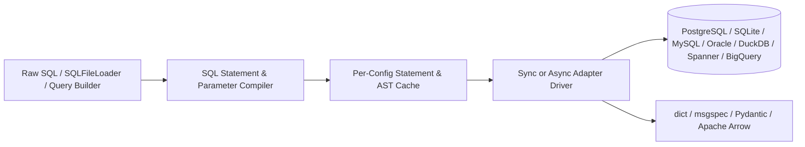

<h1 id="sqlspec" class="sqlspec-sr-only">SQLSpec</h1>

<div class="sqlspec-hero">
  <div class="sqlspec-hero-lockup">
    
    <div class="sqlspec-hero-divider" aria-hidden="true"></div>
    <span class="sqlspec-brand-text">SQLSpec</span>
  </div>
  <p class="sqlspec-hero-lead">
    SQL-first database execution for Python across synchronous and asynchronous database adapters. Write raw SQL, load named statements from <code>.sql</code> files, or compose dialect-portable queries with SQLGlot while SQLSpec handles parameter compilation, statement caching, migrations, Apache Arrow streaming, and typed row mapping.
  </p>
  <div class="sqlspec-hero-actions">
    <a class="sqlspec-cta sqlspec-cta--primary" href="learn/quickstart/">Get Started</a>
    <a class="sqlspec-cta" href="playground/">Interactive Playground</a>
    <a class="sqlspec-cta" href="databases/">Database Adapters</a>
  </div>
</div>

## Install

Install `sqlspec` with your preferred package manager. Python's built-in `sqlite3` adapter works immediately with zero extra driver packages:

=== "uv"

    ```bash
    uv add sqlspec
    ```

=== "pip"

    ```bash
    pip install sqlspec
    ```

=== "pdm"

    ```bash
    pdm add sqlspec
    ```

=== "poetry"

    ```bash
    poetry add sqlspec
    ```

Add optional database driver, schema validation, or framework extras when connecting to external engines:

=== "uv"

    ```bash
    uv add "sqlspec[asyncpg,msgspec,litestar]"
    ```

=== "pip"

    ```bash
    pip install "sqlspec[asyncpg,msgspec,litestar]"
    ```

=== "pdm"

    ```bash
    pdm add "sqlspec[asyncpg,msgspec,litestar]"
    ```

=== "poetry"

    ```bash
    poetry add "sqlspec[asyncpg,msgspec,litestar]"
    ```

## First Query

Register an adapter configuration on `SQLSpec`, open a managed session, execute parameterized SQL, and read dictionary or typed model rows:

```python
--8<-- "docs/examples/quickstart/first_query.py:example"
```

Run live SQLite queries directly in your browser in the [Interactive Playground](playground.md).

## Explore SQLSpec

| Section | What You Will Find |
| --- | --- |
| **[Learn](learn/index.md)** | Progressive SQLite-first tutorials covering configuration, querying, parameters, typed schema mapping, transactions, `.sql` files, query builders, filtering, migrations, Arrow pipelines, observability, testing, and production recipes. |
| **[Databases](/databases/)** | Central Capability Matrix plus concise setup, connection pool, type coercion, and dialect guides for PostgreSQL, CockroachDB, SQLite, MySQL, MariaDB, Oracle, SQL Server, Sybase ASE, SAP SQL Anywhere, IBM Db2, DuckDB, BigQuery, Spanner, ADBC, and Arrow ODBC. |
| **[Integrations](/integrations/)** | Unified plugin, dependency injection, session store, event queue, and agent memory guides for Litestar, Google ADK, Events, FastAPI, Starlette, Flask, Sanic, and Dishka. |
| **[Playground](playground.md)** | Zero-install WebAssembly (Pyodide) SQLite environment running `SQLSpec` directly in your browser tab. |
| **[Reference](/reference/)** | Focused API reference pages for `SQLSpec`, configurations, drivers, statements, builders, migrations, storage, data dictionaries, extensions, CLI commands, and adapter classes. |

## Core Capabilities

| Capability | Summary |
| --- | --- |
| **SQL-First Execution** | Execute raw SQL strings, load named queries from `.sql` files with `SQLFileLoader`, or compose statements programmatically with `sql.select`, `sql.insert`, `sql.update`, `sql.delete`, and `sql.merge`. |
| **Unified Sync and Async Drivers** | Consistent `execute`, `select`, `select_one`, `select_one_or_none`, `select_value`, `execute_many`, `select_stream`, and transaction APIs across synchronous and `asyncio` adapters. |
| **Typed Row Mapping** | Decode rows directly into `msgspec.Struct`, `TypedDict`, `pydantic.BaseModel`, standard library `dataclasses`, or `attrs` models via `schema_type=...`. |
| **Parameter Translation and Caching** | Bind `:named` or positional parameters uniformly while SQLSpec compiles dialect placeholders (`$1`, `%s`, `?`, `:1`, `@name`) and caches compiled AST plans across sessions. |
| **Apache Arrow and Storage Pipelines** | Stream results into `pyarrow.Table`, `RecordBatchReader`, `polars`, or `pandas` via `select_to_arrow`, and read or write Parquet and JSONL across local paths, `obstore`, and `fsspec`. |
| **Observability and Migrations** | Emit OpenTelemetry spans, Prometheus metrics, wire-level `sqlcommenter` trace tags, structured cloud logs, and manage sequential SQL or Python schema migrations from the CLI. |

## Architecture Overview


