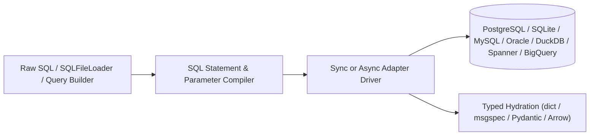

# SQLSpec

SQLSpec is a SQL-first database access library for Python with unified synchronous and asynchronous session APIs, dialect-aware parameter compilation, statement caching, schema migrations, Apache Arrow streaming, and typed row hydration across 20 database adapters.

## Installation

Install `sqlspec` with `uv` (SQLite is supported out of the box via Python's standard library):

```bash
uv add sqlspec
```

Add database or serialization extras as needed:

```bash
uv add "sqlspec[asyncpg,msgspec]"
```

## Quickstart

Configure a database adapter, open a managed session, execute parameterized SQL, and hydrate results directly into Python dictionaries or typed models:

```python
from sqlspec import SQLSpec
from sqlspec.adapters.sqlite import SqliteConfig

spec = SQLSpec()
config = spec.add_config(SqliteConfig(connection_config={"database": ":memory:"}))

with spec.provide_session(config) as session:
    session.execute("CREATE TABLE users (id INTEGER PRIMARY KEY, name TEXT, email TEXT)")
    session.execute(
        "INSERT INTO users (name, email) VALUES (:name, :email)", {"name": "Ada Lovelace", "email": "ada@example.org"}
    )
    user = session.select_one("SELECT id, name, email FROM users WHERE name = :name", {"name": "Ada Lovelace"})
```

Try live queries directly in your browser in the [Interactive Playground](playground.md).

## Core Capabilities

| Capability | Description |
| --- | --- |
| **SQL-First Execution** | Write raw SQL, load named queries from `.sql` files via `SQLFileLoader`, or compose statements with the fluent SQLGlot builder. |
| **Unified Sync & Async Drivers** | Identical `execute`, `select`, `select_one`, `select_one_or_none`, `select_value`, and transaction APIs across synchronous and `asyncio` drivers. |
| **Typed Row Hydration** | Project rows into `dict`, `msgspec.Struct`, Pydantic `BaseModel`, `dataclasses`, or `attrs` classes via `schema_type=...`. |
| **Dialect & Parameter Compilation** | Bind `:named`, `$1`, `%s`, or `?` parameters consistently with automatic dialect translation and bounded LRU statement caching. |
| **Apache Arrow & Bulk Storage** | Stream query results directly to `pyarrow.Table`, `polars`, or `pandas` and move data across local, S3/GCS (`fsspec`/`obstore`), and database storage pipelines. |
| **Framework & AI Extensions** | First-party plugins and session/event stores for Litestar, FastAPI, Starlette, Flask, Sanic, Dishka, OpenTelemetry, Prometheus, and Google ADK. |

## Architecture Overview


