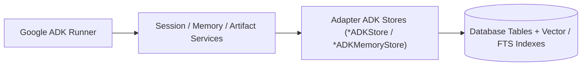

# Google ADK Integration

`sqlspec.extensions.adk` integrates SQLSpec with [Google Agent Development Kit (`google-adk >= 2.10.0`)](https://google.github.io/adk-docs/), providing persistent database-backed implementations of ADK's `BaseSessionService` (`SQLSpecSessionService`), `BaseMemoryService` (`SQLSpecMemoryService`), and `BaseArtifactService` (`SQLSpecArtifactService`) across supported database adapters.

## Installation

=== "uv"

    ```bash
    uv add "sqlspec[adk]"
    ```

=== "pip"

    ```bash
    pip install "sqlspec[adk]"
    ```

=== "pdm"

    ```bash
    pdm add "sqlspec[adk]"
    ```

=== "poetry"

    ```bash
    poetry add "sqlspec[adk]"
    ```

## Architecture and Store Services



| ADK Service | SQLSpec Class | Adapter Store Base | Responsibility |
| --- | --- | --- | --- |
| **Session & Event Store** | `SQLSpecSessionService` | `BaseAsyncADKStore` / `BaseSyncADKStore` | Persists conversation sessions (`adk_session`), app-scoped state (`app:` keys in `adk_app_state`), user-scoped state (`user:` keys in `adk_user_state`), and ordered `Event` records (`adk_event`) with optimistic revision checks and per-session concurrency locks. |
| **Long-Term Memory Store** | `SQLSpecMemoryService` | `BaseAsyncADKMemoryStore` / `BaseSyncADKMemoryStore` | Indexes conversation turns and tool outputs into `adk_memory` with substring (`simple`), full-text (`fts`), vector (`vector`), and Reciprocal Rank Fusion (`hybrid`) search. |
| **Artifact Store** | `SQLSpecArtifactService` | `BaseAsyncADKArtifactStore` / `BaseSyncADKArtifactStore` | Stores versioned artifact metadata in `adk_artifact` and binary/text payloads in `sqlspec.storage` backends (`artifact_storage_uri`) scoped by `(app_name, user_id, session_id, filename, version)` with `user:`-prefixed cross-session sharing and `artifact://` resolution. |

## Configuring ADK Extension Settings

Configure table names, full-text indexing, artifact storage URIs, and optional owner foreign keys on any adapter via `extension_config["adk"]` (`ADKConfig`):

```python
--8<-- "docs/examples/extensions/adk/backend_config.py:example"
```

### ADKConfig Options

<!-- GENERATED:START config-table:sqlspec.config.ADKConfig -->
| Key | Type | Default | Description |
| --- | --- | --- | --- |
| `migrations_path` | `str or Path` | - | Directory containing this extension's migrations, or a `'<dotted.module>:<subdir>'` specification. Overrides the default `sqlspec.extensions.<name>` lookup. Setting this auto-includes the extension in `migration_config["include_extensions"]`. |
| `manage_schema` | `bool` | `True` | Apply additive target-schema reconciliation. Default: True. |
| `create_schema` | `bool` | `True` | Create missing ADK tables during managed reconciliation. Default: True. |
| `enable_sessions` | `bool` | `True` | Enable the session store at runtime and in packaged migrations. Default: True. When False the session service is unavailable, session store operations are disabled, and packaged ADK migrations emit no session, event, state, or metadata DDL. |
| `enable_memory` | `bool` | `True` | Enable the memory store at runtime and in packaged migrations. Default: True. When False the memory service is unavailable, memory store operations are disabled, and packaged ADK migrations emit no memory table DDL or PostgreSQL vector extension statement. |
| `session_table` | `str` | `'adk_session'` | Name of the sessions table. Default: 'adk_session' |
| `events_table` | `str` | `'adk_event'` | Name of the events table. Default: 'adk_event' |
| `app_state_table` | `str` | `'adk_app_state'` | Name of the app-scoped state table. Default: 'adk_app_state' |
| `user_state_table` | `str` | `'adk_user_state'` | Name of the user-scoped state table. Default: 'adk_user_state' |
| `metadata_table` | `str` | `'adk_internal_metadata'` | Name of the internal metadata table. Default: 'adk_internal_metadata' |
| `memory_table` | `str` | `'adk_memory'` | Name of the memory entries table. Default: 'adk_memory' |
| `artifact_table` | `str` | `'adk_artifact'` | Name of the artifact metadata table. Default: 'adk_artifact' |
| `artifact_storage_uri` | `str` | - | Base URI for artifact content storage. Points to a `sqlspec/storage/` backend where artifact binary content is stored. Can be a direct URI (`s3://bucket/path`, `file:///path`) or a registered alias in the storage registry. |
| `memory_use_fts` | `bool` | `False` | Enable full-text search when supported. Default: False. When True, adapters will use their native FTS capabilities where available: |
| `memory_max_results` | `int` | `20` | Maximum number of results for memory search queries. Default: 20. Limits the number of memory entries returned by search_memory(). Can be overridden per-query via the limit parameter. |
| `owner_id_column` | `str` | - | Optional owner ID column definition to link sessions/memories to a user, tenant, team, or other entity. Format: "column_name TYPE [NOT NULL] REFERENCES table(column) [options...]" The entire definition is passed through to DDL verbatim. We only parse the column name (first word) for use in INSERT/SELECT statements. This column is added to both session and memory tables for consistent multi-tenant isolation. Supports: |
<!-- GENERATED:END config-table:sqlspec.config.ADKConfig -->

### Adapter-Specific ADKConfig Subclasses

Base `ADKConfig` contains only portable table, FTS, artifact, and schema flags. Vector embedding dimensions, vector index algorithms, and storage-level options live on adapter-specific subclasses exported by `sqlspec.adapters.<adapter>.adk`:

| Adapter Subclass | Key Fields | Purpose |
| --- | --- | --- |
| `AsyncpgADKConfig`, `PsycopgADKConfig`, `PsqlpyADKConfig` | `vector_index_type` (`"hnsw"`, `"ivfflat"`, `"scann"`), `vector_dimensions` (default `768`), `enable_bm25`, `fillfactor` (default `80`), `enable_event_generated_columns`, `enable_covering_indexes`, `scann_num_leaves`, `scann_quantizer` | Configures `pgvector` HNSW/IVFFlat/ScaNN indexes, `pg_textsearch` BM25, JSONB generated columns, and table fillfactor on PostgreSQL. |
| `SpannerADKConfig` | `shard_count`, `session_table_options`, `events_table_options`, `memory_table_options`, `expires_index_options`, `retention` (`SpannerADKRetentionConfig`), `vector_dimensions`, `vector_distance_type`, `vector_index_enabled`, `scann_tree_depth`, `scann_num_leaves` | Configures hash-shard hot-key mitigation, Spanner `ROW DELETION POLICY` TTLs (`session_ttl_seconds`, `event_ttl_seconds`, `memory_ttl_seconds`, `artifact_ttl_seconds`), and ScaNN vector indexes. |
| `AiosqliteADKConfig`, `SqliteADKConfig` | `pragma_overrides`, `fts_tokenize`, `fts_detail` (`"full"`, `"column"`, `"none"`) | Customizes SQLite PRAGMA profiles and FTS5 tokenizer/detail settings. |

## Persisting Sessions and Events

Instantiate the adapter's `*ADKStore` (such as `AiosqliteADKStore`, `AsyncpgADKStore`, `OracleAsyncADKStore`, or `SpannerAsyncADKStore`), call `await store.ensure_tables()` in standalone scripts (or run `sqlspec upgrade` in production), and pass the store to `SQLSpecSessionService(store)` or call the store directly:

```python
--8<-- "docs/examples/extensions/adk/memory_store.py:example"
```

When wiring an ADK `Runner`, pass `SQLSpecSessionService(store)`, `SQLSpecMemoryService(memory_store)`, and `SQLSpecArtifactService(artifact_store, artifact_storage_uri)` inside an async context manager (`async with SQLSpecSessionService(store) as session_service:`) so session locks and resources close cleanly on shutdown.

## Full-Text, Vector, and Hybrid RRF Memory Search

`ADKMemoryStore` (`AiosqliteADKMemoryStore`, `AsyncpgADKMemoryStore`, `OracleAsyncADKMemoryStore`, `SpannerAsyncADKMemoryStore`, `DuckDBADKMemoryStore`) supports four search modes across engines:

1. **Simple (`simple`)**: Portable case-insensitive substring matching across all ADK-enabled adapters.
2. **Full-Text (`fts`)**: Native lexical ranking (`FTS5` on `sqlite`/`aiosqlite`, `tsvector` or `pg_textsearch` BM25 on PostgreSQL, Oracle Text `CONTAINS` with `"AND"`, `"OR"`, `"ACCUM"`, and `"NEAR"` operators, `MATCH ... AGAINST` on MySQL, and `TOKENIZE_FULLTEXT`/`SEARCH` on Spanner).
3. **Vector (`vector`)**: Cosine or inner-product similarity search on `asyncpg`, `psycopg`, `psqlpy`, `adbc` (`pgvector`), `oracledb` (Oracle 26ai HNSW `FETCH APPROX FIRST` or exact top-K), `spanner` (`APPROX_COSINE_DISTANCE`), and `duckdb` (`array_cosine_similarity`).
4. **Hybrid RRF (`hybrid`)**: Single-round-trip Reciprocal Rank Fusion (`1 / (k + rank)`) combining vector distance and full-text rank in one SQL CTE on PostgreSQL (`asyncpg`, `psycopg`, `psqlpy`, `adbc`), Oracle 26ai (`oracledb`), Cloud Spanner (`spanner`), and DuckDB (`duckdb`).

```python
--8<-- "docs/examples/extensions/adk/tool_integration.py:example"
```

## Versioned Artifact Storage

`SQLSpecArtifactService` implements Google ADK's `BaseArtifactService` by combining SQL metadata persistence (`adk_artifact` managed by a `BaseAsyncADKArtifactStore` or `BaseSyncADKArtifactStore` subclass) with `sqlspec.storage` object backends (`file://`, `s3://`, `gs://`, `az://`, or a registered storage alias):

```python
from google.genai import types
from sqlspec.extensions.adk import (
    BaseAsyncADKArtifactStore,
    SQLSpecArtifactService,
)


async def save_and_load_report(
    artifact_store: BaseAsyncADKArtifactStore,
) -> types.Part | None:
    artifact_service = SQLSpecArtifactService(
        store=artifact_store,
        artifact_storage_uri="file:///var/lib/app/adk-artifacts",
    )
    await artifact_service.save_artifact(
        app_name="docs",
        user_id="user_1",
        session_id="session_1",
        filename="report.txt",
        artifact=types.Part.from_text(text="Quarterly revenue summary"),
        custom_metadata={"source": "finance_agent"},
    )
    return await artifact_service.load_artifact(
        app_name="docs",
        user_id="user_1",
        session_id="session_1",
        filename="report.txt",
    )
```

Prefixing a filename with `user:` (for example, `"user:profile.json"`) scopes the artifact across all sessions belonging to `user_id` within `app_name`.

## Production Domain AI Runtime Wiring

In production applications, structure agent stores within an `app/domain/ai/runtime/` service factory, using `AsyncpgADKConfig` for PostgreSQL vector settings and enabling `"adk"` extension migrations so revisions are tracked automatically by the CLI:

```python
"""Domain AI runtime wiring for Google ADK stores."""

from pathlib import Path

from sqlspec import SQLSpec
from sqlspec.adapters.asyncpg import AsyncpgConfig
from sqlspec.adapters.asyncpg.adk import (
    AsyncpgADKConfig,
    AsyncpgADKMemoryStore,
    AsyncpgADKStore,
)
from sqlspec.extensions.adk import (
    SQLSpecMemoryService,
    SQLSpecSessionService,
)

BASE_DIR = Path(__file__).resolve().parent.parent.parent.parent


def create_adk_services(
    spec: SQLSpec,
) -> tuple[SQLSpecSessionService, SQLSpecMemoryService]:
    """Wire ADK session and memory services on an AsyncpgConfig instance."""
    config = spec.add_config(
        AsyncpgConfig(
            bind_key="ai",
            connection_config={"dsn": "postgresql://localhost/app"},
            migration_config={
                "script_location": str(BASE_DIR / "db" / "migrations"),
                "include_extensions": ["adk"],
            },
            extension_config={
                "adk": AsyncpgADKConfig(
                    session_table="adk_session",
                    events_table="adk_event",
                    memory_table="adk_memory",
                    memory_use_fts=True,
                    vector_dimensions=768,
                    vector_index_type="hnsw",
                    memory_max_results=20,
                )
            },
        )
    )

    session_store = AsyncpgADKStore(config)
    memory_store = AsyncpgADKMemoryStore(config)

    return (
        SQLSpecSessionService(session_store),
        SQLSpecMemoryService(memory_store),
    )
```

## Schema Migrations, CLI, and Retention Maintenance

Instead of calling `ensure_tables()` at runtime in production, enable `"adk"` in `migration_config={"include_extensions": ["adk"]}` (or configure `extension_config["adk"]`, which auto-includes ADK migrations) so `sqlspec upgrade` tracks ADK schema revisions alongside your application migrations.

Use the built-in `sqlspec adk memory` CLI commands to verify table reachability or delete memory entries older than a retention threshold:

```bash
sqlspec --config myapp.db.spec adk memory verify
sqlspec --config myapp.db.spec adk memory cleanup --days 90
```

For scheduled cron jobs, background workers, or administrative endpoints, `sqlspec.extensions.adk.maintenance` provides standalone async and sync retention helpers that return a `PruneReport` (`deleted_count`, `elapsed_ms`, `table`):

| Helper (Async / Sync) | Target Accepted | Retention Parameter | Default Table Pruned |
| --- | --- | --- | --- |
| `prune_sessions` / `prune_sessions_sync` | `ADKStore`, `*Config`, or driver | `idle_days: int = 30`, `app_name: str or None = None` | `adk_session` |
| `prune_events` / `prune_events_sync` | `ADKStore`, `*Config`, or driver | `older_than_days: int = 90`, `app_name: str or None = None` | `adk_event` |
| `prune_memory` / `prune_memory_sync` | `ADKMemoryStore`, `*Config`, or driver | `older_than_days: int = 90`, `app_name: str or None = None`, `scope: "all" or "user" or "app" = "user"` | `adk_memory` |
| `prune_user_state` / `prune_user_state_sync` | `ADKStore`, `*Config`, or driver | `idle_days: int = 180`, `app_name: str or None = None` | `adk_user_state` |
| `prune_artifacts` / `prune_artifacts_sync` | `SQLSpecArtifactService` | `older_than_days: int = 90`, `app_name: str or None = None` | `adk_artifact` (plus storage blobs) |

```python
from sqlspec.adapters.asyncpg import AsyncpgConfig
from sqlspec.extensions.adk import (
    PruneReport,
    SQLSpecArtifactService,
    prune_artifacts,
    prune_events,
    prune_memory,
    prune_sessions,
    prune_user_state,
)


async def run_daily_adk_retention(
    config: AsyncpgConfig,
    artifact_service: SQLSpecArtifactService,
) -> list[PruneReport]:
    return [
        await prune_sessions(config, idle_days=30, app_name="support_agent"),
        await prune_events(config, older_than_days=90, app_name="support_agent"),
        await prune_memory(
            config, older_than_days=90, app_name="support_agent", scope="user"
        ),
        await prune_user_state(config, idle_days=180, app_name="support_agent"),
        await prune_artifacts(
            artifact_service, older_than_days=90, app_name="support_agent"
        ),
    ]
```

## Recap

- Configure ADK tables, FTS, and artifact URIs in `extension_config["adk"]` (`ADKConfig`), and use adapter-specific subclasses (`AsyncpgADKConfig`, `SpannerADKConfig`) for vector index and storage settings.
- Pair `SQLSpecSessionService`, `SQLSpecMemoryService`, and `SQLSpecArtifactService` with your adapter's `adk` store classes.
- See the [Database Capability Matrix](../databases/index.md) for per-adapter ADK vector/FTS support and the [ADK Extension Reference](/reference/extensions/adk/) for full API signatures.
