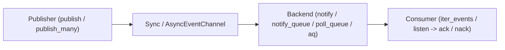

# Events and Message Queues

`sqlspec.extensions.events` provides synchronous (`SyncEventChannel`) and asynchronous (`AsyncEventChannel`) pub/sub and competing-consumer event channels backed by your existing database configuration, supporting native PostgreSQL `LISTEN`/`NOTIFY`, durable hybrid `notify_queue` wakeups, Oracle Advanced Queuing (`aq` and `txeventq`), and portable table-backed polling (`poll_queue`) across supported database adapters.



## Choosing a Transport Backend

Set `extension_config["events"]["backend"]` according to your delivery and durability requirements:

| Backend | Supported Adapters | Durability | Delivery Model | Default On |
| --- | --- | --- | --- | --- |
| `"notify"` | `asyncpg`, `psycopg`, `psqlpy` | Transient (in-memory wire notification) | Fire-and-forget broadcast wakeup (`<= 7,999` UTF-8 bytes) | PostgreSQL (`asyncpg`, `psycopg`, `psqlpy`) |
| `"notify_queue"` | `asyncpg`, `psycopg`, `psqlpy` | Durable table row + native `NOTIFY` wakeup | Competing-consumer queue with instant push wakeup and periodic poll reconciliation | Opt-in on PostgreSQL |
| `"poll_queue"` | All event-capable adapters | Durable table row (`sqlspec_event_queue`) | Competing-consumer queue with leased claims, `ack`/`nack`, and retry backoff | All non-PostgreSQL adapters |
| `"aq"` | `oracledb` (sync & async) | Durable Oracle Advanced Queuing table | Native `DBMS_AQ` enqueue/dequeue in `python-oracledb` Thin mode | Opt-in on Oracle 21c+ / 26ai |
| `"txeventq"` | `oracledb` (sync & async) | Durable Oracle Transactional Event Queue | Native high-throughput partitioned TxEventQ in Thin mode | Opt-in on Oracle 21c+ / 26ai |

## Configuring EventsConfig and Publishing Events

Configure the `events` extension on your database config (`EventsConfig`). When `manage_schema=True` and `create_schema=True` (the defaults), `sqlspec upgrade` automatically provisions and reconciles the queue table (`sqlspec_event_queue` by default); for standalone in-memory setups without running CLI migrations, call `await store.reconcile_schema_async(driver)` (or `store.reconcile_schema_sync(driver)`) on the adapter's `*EventQueueStore`. Channel names must be valid SQL identifiers (`^[A-Za-z_][A-Za-z0-9_]*$`, such as `"orders_created"`):

<!-- GENERATED:START config-table:sqlspec.config.EventsConfig -->
| Key | Type | Default | Description |
| --- | --- | --- | --- |
| `migrations_path` | `str or Path` | - | Directory containing this extension's migrations, or a `'<dotted.module>:<subdir>'` specification. Overrides the default `sqlspec.extensions.<name>` lookup. Setting this auto-includes the extension in `migration_config["include_extensions"]`. |
| `manage_schema` | `bool` | `True` | Apply additive target-schema reconciliation. Default: True. |
| `create_schema` | `bool` | `True` | Create the queue table during managed reconciliation. Default: True. |
| `backend` | `Literal['notify', 'notify_queue', 'poll_queue', 'aq', 'txeventq']` | - | Backend implementation. PostgreSQL adapters default to 'notify', others to 'poll_queue'. notify: Transient PostgreSQL LISTEN/NOTIFY wakeup; not a durable event ledger; notify_queue: Durable table queue with PostgreSQL LISTEN/NOTIFY wakeups; poll_queue: Durable table queue discovered by polling; aq: Oracle Advanced Queuing; txeventq: Oracle Transactional Event Queues |
| `queue_table` | `str` | - | Name of the fallback queue table. Defaults to 'sqlspec_event_queue'. |
| `lease_seconds` | `int` | `30` | Lease duration for claimed events before they can be retried. Defaults to 30 seconds. |
| `retention_seconds` | `int` | `86400` | Retention window for acknowledged events before cleanup. Defaults to 86400 (24 hours). |
| `poll_interval` | `float` | `1.0` | Compatibility alias for event_poll_interval. Defaults to 1.0. |
| `event_poll_interval` | `float` | - | Durable event reconciliation interval in seconds. Takes precedence over poll_interval. |
| `select_for_update` | `bool` | `False` | Use SELECT FOR UPDATE locking when claiming events. Defaults to False. |
| `skip_locked` | `bool` | `False` | Use SKIP LOCKED for non-blocking event claims. Defaults to False. |
| `shard_count` | `int` | `1` | Number of hash shards for queue table and index prefixing (e.g. Cloud Spanner). Defaults to 1. |
| `migration_mode` | `ExtensionMigrationMode` | `'reconcile'` | Extension migration strategy (`'versioned'` or `'reconcile'`). Default: `'reconcile'`. |
<!-- GENERATED:END config-table:sqlspec.config.EventsConfig -->

```python
import asyncio
from sqlspec import SQLSpec
from sqlspec.adapters.aiosqlite import AiosqliteConfig
from sqlspec.adapters.aiosqlite.events import AiosqliteEventQueueStore
from sqlspec.extensions.events import EventMessage


async def main() -> None:
    spec = SQLSpec()
    config = spec.add_config(
        AiosqliteConfig(
            connection_config={"database": ":memory:"},
            extension_config={
                "events": {
                    "backend": "poll_queue",
                    "queue_table": "app_events",
                    "lease_seconds": 30,
                    "retention_seconds": 3600,
                    "event_poll_interval": 0.25,
                }
            },
        )
    )
    try:
        store = AiosqliteEventQueueStore(config)
        async with config.provide_session() as driver:
            await store.reconcile_schema_async(driver)

        channel = spec.event_channel(config)
        event_id = await channel.publish(
            "orders_created",
            {"order_id": 101, "status": "paid"},
            metadata={"source": "checkout"},
        )

        async for message in channel.iter_events(
            "orders_created", poll_interval=0.1
        ):
            assert message.event_id == event_id
            await channel.ack(message.event_id)
            break

        async def handle_order(msg: EventMessage) -> None:
            if msg.payload.get("retry"):
                await channel.nack(msg.event_id)
                return
            await channel.ack(msg.event_id)

        listener = channel.listen(
            "orders_created", handle_order, auto_ack=False
        )
        await channel.stop_listener(listener.id)
        await channel.shutdown()
    finally:
        await config.close_pool()


asyncio.run(main())
```

### Batch Publication

Both `AsyncEventChannel` and `SyncEventChannel` provide `publish_many(events)` where each item is a `(channel, payload, metadata)` tuple. On `poll_queue` and `notify_queue`, SQLSpec bulk-inserts all rows in a single publisher transaction; on `notify_queue`, it emits a single compact wakeup marker (`marker_id` + `batch_size`) per channel in the same transaction so consumers drain the batch immediately.

### Schema Reconciliation

`migration_mode="reconcile"` is the default for extensions. Reconciliation converges durable event queue tables and companion claim indexes on every `sqlspec upgrade` without recording new `ext_events_*` ledger rows, preserves the queue table during partial downgrades, and drops it when `downgrade` reaches `base` while honoring `manage_schema` and `create_schema` (see [Migrations](../learn/migrations.md)):

```python
extension_config = {
    "events": {
        "backend": "poll_queue",
        "migration_mode": "reconcile",
    }
}
```

When `backend="notify"` (transient PostgreSQL `LISTEN`/`NOTIFY`), reconciliation is a no-op because no durable queue table is used. When `backend` is `"aq"` or `"txeventq"` on Oracle 21c+ (`oracledb`), reconciliation converges the queue table and companion index and provisions and starts the native `DBMS_AQADM` queue table and queue (`aq_queue`, or one queue per channel listed in `aq_channels` when `aq_queue` contains `{channel}`). `aq_channels` only enumerates queues to provision during head upgrades and never restricts runtime `publish` or dequeue channels. Reconciliation raises `MigrationError` when a `{channel}` `aq_queue` template has no `aq_channels`, when `create_schema=False` and a target queue is missing, on Oracle `< 21c`, or when the database user lacks the `DBMS_AQADM` execute grant.

| Adapter Family | Built-In Adapters | Reconcile Scope and Boundaries |
| --- | --- | --- |
| PostgreSQL | `asyncpg`, `psycopg`, `psqlpy` | No-op when `backend="notify"`; converges `sqlspec_event_queue`, companion polling index, and `fillfactor`/autovacuum storage options for `"poll_queue"` and `"notify_queue"`. |
| Oracle | `oracledb` | Converges version-detected JSON/BLOB queue tables and companion indexes for `"poll_queue"`, plus native `DBMS_AQADM` JSON queue tables and started queues (`aq_queue` and `aq_channels`) for `"aq"` and `"txeventq"`. |
| Embedded, OLTP, and Arrow ODBC | `sqlite`, `aiosqlite`, `cockroach_asyncpg`, `cockroach_psycopg`, `aiomysql`, `asyncmy`, `pymysql`, `mysqlconnector`, `duckdb`, `mssql_python`, `pymssql`, `db2`, `sqlanywhere`, `sybase`, `teradata`, `arrow_odbc` (`mssql`, `tsql`, `db2`) | Converges `poll_queue` tables, additive columns, and companion claim/polling indexes. |
| Cloud Spanner, BigQuery, and Snowflake | `spanner`, `bigquery`, `snowflake` | Converges `poll_queue` tables (`shard_count` prefixing and TTL-compatible indexes on `spanner`; partitioned queue tables and nullable-only additive column repair on `bigquery`; warehouse queue tables without secondary indexes on `snowflake`). |
| Multi-backend ADBC | `adbc` | Converges `poll_queue` tables and companion indexes across all ADBC backends with a resolved dialect. ADBC over FlightSQL needs an explicit `statement_config` dialect or `gizmosql_backend`. |

## PostgreSQL ListenerHub and Pooler Routing

On PostgreSQL (`asyncpg`, `psycopg`, `psqlpy`), `notify` and `notify_queue` manage a single persistent `LISTEN` connection per backend instance via `ListenerHub`:

1. **Minimum Pool Size**: Because the `ListenerHub` holds one dedicated connection for `LISTEN` while publishers use pooled sessions, configure `max_size >= 2` (or `max_db_pool_size >= 2` on `psqlpy`).
2. **PgBouncer / AlloyDB Auth Proxy (`pooler_mode` + `direct_dsn`)**: Transaction and statement poolers multiplex backend connections and cannot hold session-scoped `LISTEN` registrations. When `pooler_mode` is `"transaction"` or `"statement"` and `direct_dsn` is configured, `ListenerHub` automatically routes its dedicated `LISTEN` connection through `config.derive_direct_config()` while normal application queries continue using the pooled endpoint:

```python
from sqlspec.adapters.asyncpg import AsyncpgConfig
from sqlspec.adapters.asyncpg.events import AsyncpgEventsConfig

config = AsyncpgConfig(
    connection_config={
        "dsn": "postgresql://pgbouncer:6432/app",
        "min_size": 2,
        "max_size": 20,
    },
    driver_features={
        "pooler_mode": "transaction",
        "direct_dsn": "postgresql://postgres-primary:5432/app",
    },
    extension_config={
        "events": AsyncpgEventsConfig(
            backend="notify_queue",
            event_poll_interval=1.0,
            listener_queue_capacity=256,
            fillfactor=80,
        )
    },
)
```

### Checking PostgreSQL NOTIFY Payload Budgets

PostgreSQL caps `NOTIFY` payloads at `7,999` UTF-8 bytes across the full encoded event envelope (`event_id`, `payload`, `metadata`, and timestamp). Use `fits_notify_payload` and `measure_notify_payload` before publishing to a transient `notify` channel, or use `notify_queue` so arbitrary-sized payloads live in the durable queue table while `NOTIFY` carries only a compact wakeup marker.

## Adapter-Specific Storage Tuning

Several adapters export typed `EventsConfig` subclasses under `sqlspec.adapters.<adapter>.events` for storage-level optimizations:

- **PostgreSQL (`AsyncpgEventsConfig`, `PsycopgEventsConfig`, `PsqlpyEventsConfig`)**: `fillfactor` (`10`–`100`) and autovacuum scale factors on all three, plus `listener_queue_capacity` on `AsyncpgEventsConfig` and `PsycopgEventsConfig`.
- **SQLite (`SqliteEventsConfig`, `AiosqliteEventsConfig`)**: PRAGMA profile and overrides for high-concurrency WAL queue polling.
- **Cloud Spanner (base `EventsConfig` on `SpannerSyncConfig` / `SpannerAsyncConfig`)**: `shard_count > 1` hash-shard prefixing to prevent queue-head hotspots. The adapter also uses snapshot-read candidate polling and keeps acknowledged rows for native `ROW DELETION POLICY` TTL cleanup instead of deleting them on `ack`.
- **BigQuery (`BigQueryEventsConfig`)**: `partitioning=True` (`DATE(available_at)` partitioning), `partition_expiration_days`, and `require_partition_filter`.
- **Oracle (`OracleEventsConfig`)**: `backend="aq"` or `"txeventq"`, `aq_queue` (`"SQLSPEC_EVT_{channel}"` per-channel routing), `aq_channels` (channel list provisioned during `migration_mode="reconcile"` upgrades for `{channel}` queue templates), `aq_visibility` (`"DEQ_ON_COMMIT"` / `"DEQ_IMMEDIATE"`), `OracleEventsPartitionConfig`, and `OracleEventsCompressionConfig`.

## Recap

- Choose `notify_queue` on PostgreSQL for instant wakeup with durable table storage, `aq` / `txeventq` on Oracle for native broker queues, and `poll_queue` for zero-dependency portable queues across all event-capable adapters.
- Set `direct_dsn` alongside `pooler_mode="transaction"` on PostgreSQL so `ListenerHub` bypasses transaction poolers automatically.
- See the [Events Extension Reference](/reference/extensions/events/) for `AsyncEventChannel`, `SyncEventChannel`, `EventMessage`, and `EventsConfig` details.
