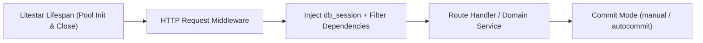

# Litestar Integration

`sqlspec.extensions.litestar` provides `SQLSpecPlugin`, wiring SQLSpec connection pools into Litestar's application lifespan, registering request-scoped session and connection dependencies, mounting `litestar database` CLI migration commands, providing declarative query filter dependencies, and supplying server-side Litestar `Store` implementations across supported database adapters.

## Installation

=== "uv"

    ```bash
    uv add "sqlspec[litestar]"
    ```

=== "pip"

    ```bash
    pip install "sqlspec[litestar]"
    ```

=== "pdm"

    ```bash
    pdm add "sqlspec[litestar]"
    ```

=== "poetry"

    ```bash
    poetry add "sqlspec[litestar]"
    ```

## Plugin Setup and Session Injection



Register one or more database configurations on a `SQLSpec` instance, configure `extension_config["litestar"]`, and pass `SQLSpecPlugin(sqlspec=spec)` to `Litestar(plugins=[...])`:

```python
--8<-- "docs/examples/extensions/litestar/plugin_setup.py:example"
```

By default, a single configuration registers `db_session`, `db_connection`, and `db_pool` in Litestar's dependency graph. Override `session_key`, `connection_key`, or `pool_key` inside `extension_config["litestar"]` to customize parameter names.

## Multi-Database Dependency Keys

When an application connects to multiple databases (for example, a transactional primary database and a read-heavy analytics database), assign a distinct `bind_key` and `session_key` to each configuration:

```python
--8<-- "docs/examples/extensions/litestar/dependency_keys.py:example"
```

## Transaction Commit Modes

Configure `commit_mode` inside `extension_config["litestar"]` to control how request-scoped sessions finalize when a route handler returns:

| Commit Mode | Commits On | Rolls Back On | Best For |
| --- | --- | --- | --- |
| `"manual"` (default) | Explicit `session.commit()` calls only | Unhandled exceptions or uncommitted changes at request exit | Explicit service-layer transaction boundaries |
| `"autocommit"` | HTTP `200`–`299` responses | HTTP `>= 300` responses (`3xx`, `4xx`, `5xx`) or unhandled exceptions | JSON REST APIs where every `2xx` handler mutates state |
| `"autocommit_include_redirect"` | HTTP `200`–`399` responses | HTTP `>= 400` responses or unhandled exceptions | HTML / HTMX form handlers that commit and return `302` / `303` redirects |

```python
--8<-- "docs/examples/frameworks/litestar/commit_modes.py:example"
```

Add `extra_commit_statuses` or `extra_rollback_statuses` in `LitestarConfig` when specific status codes require custom commit or rollback treatment.

## Declarative Query Filter Providers

Use `create_filter_dependencies` with `FilterConfig` to generate OpenAPI-documented Litestar dependencies that parse query parameters directly into `StatementFilter` lists (`LimitOffsetFilter`, `OrderByFilter`, `SearchFilter`, `BeforeAfterFilter`, `CursorFilter`, and `InCollectionFilter`):

```python
from datetime import datetime
from typing import Annotated, Any
from uuid import UUID

from litestar import Litestar, get
from litestar.params import Dependency

from sqlspec.adapters.asyncpg import AsyncpgDriver
from sqlspec.core import FilterTypes
from sqlspec.extensions.litestar.providers import (
    FilterConfig,
    create_filter_dependencies,
)

user_filters = create_filter_dependencies(
    FilterConfig(
        id_filter=UUID,
        id_field="id",
        sort_field="created_at",
        sort_order="desc",
        pagination_type="limit_offset",
        pagination_size=25,
        pagination_max_size=100,
        search="name,email",
        search_ignore_case=True,
        created_at=True,
        updated_at=True,
    )
)


@get("/users", dependencies=user_filters)
async def list_users(
    db_session: AsyncpgDriver,
    filters: Annotated[list[FilterTypes], Dependency(skip_validation=True)],
) -> list[dict[str, Any]]:
    return await db_session.select(
        "SELECT id, name, email, created_at FROM users", *filters
    )
```

For bidirectional keyset pagination (`CursorPagination`), set `cursor_key="id"` (or pass `CursorKey` specs) on `FilterConfig`; see [Filtering and Pagination](../learn/filtering-and-pagination.md).

## Server-Side Session Stores

Supported database adapters expose a Litestar `Store` implementation under `sqlspec.adapters.<adapter>.litestar` (`AsyncpgStore`, `PsycopgSyncStore`, `PsycopgAsyncStore`, `PsqlpyStore`, `CockroachAsyncpgStore`, `CockroachPsycopgSyncStore`, `CockroachPsycopgAsyncStore`, `AiosqliteStore`, `SQLiteStore`, `AsyncmyStore`, `AiomysqlStore`, `PyMysqlStore`, `MysqlConnectorSyncStore`, `MysqlConnectorAsyncStore`, `OracleSyncStore`, `OracleAsyncStore`, `MssqlPythonStore`, `PymssqlStore`, `SybaseStore`, `SqlanywhereStore`, `Db2SyncStore`, `Db2AsyncStore`, `DuckdbStore`, `BigQueryStore`, `SpannerSyncStore`, `SpannerAsyncStore`, `ADBCStore`, and `ArrowOdbcStore`):

```python
--8<-- "docs/examples/frameworks/litestar/session_stores.py:example"
```

Call `await store.create_table()` during application startup (or include the extension migration via `include_extensions=["litestar"]` in `migration_config`) and pass the store to Litestar's `ServerSideSessionConfig` or `stores={"sessions": store}` registry.

## Production Litestar + Dishka Architecture

In enterprise microservices, teams often combine Litestar's HTTP routing, OpenAPI documentation, and lifecycle management with Dishka's unified dependency container. To prevent conflicting dependency injection providers while allowing Litestar to manage database pool startup and teardown, configure `SQLSpecPlugin` with `disable_di=True` and `manage_lifespan=True`:

```python
"""Production Litestar and Dishka composition root."""

from collections.abc import AsyncIterator
from typing import Annotated

from dishka import FromDishka, Provider, Scope, make_async_container, provide
from dishka.integrations.litestar import DishkaPlugin, setup_dishka
from litestar import Controller, Litestar, get
import msgspec

from sqlspec import SQLSpec
from sqlspec.adapters.asyncpg import AsyncpgConfig, AsyncpgDriver
from sqlspec.extensions.litestar import SQLSpecPlugin


class Account(msgspec.Struct, frozen=True, gc=False):
    """Account projection entity."""

    id: int
    name: str


class DatabaseProvider(Provider):
    """Scoped Dishka provider managing config and driver lifecycles."""

    @provide(scope=Scope.APP)
    def provide_spec(self) -> tuple[SQLSpec, AsyncpgConfig]:
        spec = SQLSpec()
        config = spec.add_config(
            AsyncpgConfig(
                bind_key="primary",
                connection_config={"dsn": "postgresql://localhost/app"},
                extension_config={
                    "litestar": {
                        "disable_di": True,
                        "manage_lifespan": True,
                        "session_table": "app_session",
                    }
                },
                migration_config={"include_extensions": ["litestar", "adk"]},
            )
        )
        return spec, config

    @provide(scope=Scope.REQUEST)
    async def provide_driver(
        self, app_deps: tuple[SQLSpec, AsyncpgConfig]
    ) -> AsyncIterator[AsyncpgDriver]:
        spec, config = app_deps
        async with spec.provide_session(config) as session:
            yield session


class AccountController(Controller):
    path = "/accounts"

    @get("/{account_id:int}")
    async def get_account(
        self, account_id: int, driver: Annotated[AsyncpgDriver, FromDishka()]
    ) -> Account:
        """Fetch account record using Dishka-injected driver session."""
        return await driver.select_one(
            """
            SELECT id, name
            FROM accounts
            WHERE id = :id
            """,
            id=account_id,
            schema_type=Account,
        )


def create_app() -> Litestar:
    """Build Litestar application wired with SQLSpec and Dishka."""
    provider = DatabaseProvider()
    spec, _ = provider.provide_spec()
    container = make_async_container(provider)

    app = Litestar(
        route_handlers=[AccountController],
        plugins=[SQLSpecPlugin(sqlspec=spec), DishkaPlugin()],
    )
    setup_dishka(container, app)
    return app
```

## Recap

- `SQLSpecPlugin` manages pool lifecycles, injects `db_session` / `db_connection` / `db_pool`, and registers `litestar database` CLI commands automatically.
- Set `commit_mode`, `session_key`, `enable_correlation_middleware`, and `enable_sqlcommenter_middleware` in `extension_config["litestar"]`.
- When integrating with Dishka, set `disable_di=True` and `manage_lifespan=True` on `extension_config["litestar"]`.
- See the [Litestar Extension Reference](/reference/extensions/litestar/) for `SQLSpecPlugin`, `LitestarConfig`, and `FilterConfig` signatures.
