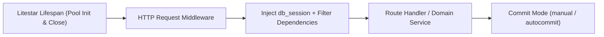

# Litestar Integration

`sqlspec.extensions.litestar` provides `SQLSpecPlugin`, wiring SQLSpec connection pools into Litestar's application lifespan, registering request-scoped session and connection dependencies, mounting `litestar db` / `litestar database` and `litestar sessions delete-expired` CLI commands, providing declarative query filter dependencies, and supplying server-side Litestar `Store` and `ChannelsBackend` implementations across supported database adapters.

## Installation

=== "uv"

    ```bash
    uv add "sqlspec[litestar]"
    ```

=== "pip"

    ```bash
    pip install "sqlspec[litestar]"
    ```

=== "pdm"

    ```bash
    pdm add "sqlspec[litestar]"
    ```

=== "poetry"

    ```bash
    poetry add "sqlspec[litestar]"
    ```

## Plugin Setup and Session Injection



Register one or more database configurations on a `SQLSpec` instance, configure `extension_config["litestar"]`, and pass `SQLSpecPlugin(sqlspec=spec)` to `Litestar(plugins=[...])`:

```python
--8<-- "docs/examples/extensions/litestar/plugin_setup.py:example"
```

By default, a single configuration registers `db_session`, `db_connection`, and `db_pool` in Litestar's dependency graph. Override `session_key`, `connection_key`, or `pool_key` inside `extension_config["litestar"]` to customize parameter names.

## Configuration Options

Configure `extension_config["litestar"]` (`LitestarConfig`) per database configuration:

<!-- GENERATED:START config-table:sqlspec.config.LitestarConfig -->
| Key | Type | Default | Description |
| --- | --- | --- | --- |
| `migrations_path` | `str or Path` | - | Directory containing this extension's migrations, or a `'<dotted.module>:<subdir>'` specification. Overrides the default `sqlspec.extensions.<name>` lookup. Setting this auto-includes the extension in `migration_config["include_extensions"]`. |
| `session_table` | `bool or str` | - | Enable session table for server-side session storage. `True`: Use default table name ('litestar_session'); `"custom_name"`: Use custom table name. When set, litestar extension migrations are auto-included to create the session table. If you're only using litestar for DI/connection management (not session storage), leave this unset to skip the migrations. |
| `connection_key` | `str` | `'db_connection'` | Key for storing connection in ASGI scope. Default: 'db_connection' |
| `pool_key` | `str` | `'db_pool'` | Key for storing connection pool in application state. Default: 'db_pool' |
| `session_key` | `str` | `'db_session'` | Key for storing session in ASGI scope. Default: 'db_session' |
| `commit_mode` | `Literal['manual', 'autocommit', 'autocommit_include_redirect']` | `'manual'` | Transaction commit mode. Default: 'manual' |
| `enable_correlation_middleware` | `bool` | `True` | Enable request correlation ID middleware. Default: True |
| `correlation_header` | `str` | `X-Request-ID` | HTTP header to read the request correlation ID from when middleware is enabled. Default: `X-Request-ID` |
| `correlation_headers` | `tuple[str, ...] or list[str]` | - | Additional HTTP headers to read as correlation ID fallbacks. |
| `auto_trace_headers` | `bool` | `True` | Read standard trace context headers as correlation ID fallbacks. Default: True. |
| `extra_commit_statuses` | `set[int]` | `set()` | Additional HTTP status codes that trigger commit. Default: set() |
| `extra_rollback_statuses` | `set[int]` | `set()` | Additional HTTP status codes that trigger rollback. Default: set() |
| `disable_di` | `bool` | `False` | Disable built-in dependency injection. Default: False. When True, the Litestar plugin will not register dependency providers for database connections, pools, and sessions, or the per-request handler that commits and closes request connections. Pool startup and shutdown follow `manage_lifespan`, which defaults to False when `disable_di` is True. |
| `manage_lifespan` | `bool` | - | Register the plugin's pool lifespan handler. Default: the inverse of `disable_di`. When True, the Litestar plugin creates the configuration's pool on application startup, stores it in application state under `pool_key`, and closes it on shutdown, whether or not `disable_di` is set. Set to True alongside `disable_di=True` to keep pool lifecycle management while another DI solution provides connections and sessions. When False, the application creates and closes the pool itself; with dependency injection enabled, the plugin's providers still read the pool from application state under `pool_key`. |
| `enable_sqlcommenter_middleware` | `bool` | `True` | Control automatic SQLCommenter middleware registration. Default: True. When the driver's :class:`~sqlspec.core.statement.StatementConfig` has `enable_sqlcommenter=True`, the middleware is registered automatically. Set to `False` to explicitly disable middleware registration even when SQLCommenter is enabled on the driver config. |
| `manage_schema` | `bool` | `True` | Apply additive session-table reconciliation. Default: True. |
| `create_schema` | `bool` | `True` | Create a missing session table during managed reconciliation. Default: True. |
<!-- GENERATED:END config-table:sqlspec.config.LitestarConfig -->

## Multi-Database Dependency Keys

When an application connects to multiple databases (for example, a transactional primary database and a read-heavy analytics database), assign a distinct `bind_key` and `session_key` to each configuration:

```python
--8<-- "docs/examples/extensions/litestar/dependency_keys.py:example"
```

## On-Demand Session and Connection Acquisition

In custom guards, middleware, streaming iterators, or event hooks where standard route dependency injection is not active, `SQLSpecPlugin` exposes direct scope-backed session and connection accessors. Connections acquired before `http.response.start` are finalized in `before_send`, while connections acquired after `http.response.start` (such as inside `Stream` responses or `after_response` hooks) are finalized by `ConnectionCleanupMiddleware` when the ASGI request completes:

- `plugin.provide_request_session(key, state, scope)` and `plugin.provide_request_connection(key, state, scope)` (when the connection already exists in ASGI scope).
- `plugin.provide_request_session_sync(key, state, scope)` and `plugin.provide_request_connection_sync(key, state, scope)` (acquires a sync connection on demand if not yet present in `scope`).
- `await plugin.provide_request_session_async(key, state, scope)` and `await plugin.provide_request_connection_async(key, state, scope)` (acquires an async connection on demand if not yet present in `scope`).

## Automatic HTTP 404 and 409 Exception Mapping

During `SQLSpecPlugin.on_app_init`, the plugin registers two default exception handlers unless your application already defines custom handlers for those exception types:

- `not_found_error_handler`: Maps `sqlspec.exceptions.NotFoundError` (such as `select_one` returning zero rows) to an HTTP `404 NotFoundException` response.
- `integrity_error_handler`: Maps `sqlspec.exceptions.IntegrityError` (including `UniqueViolationError`, `ForeignKeyViolationError`, and `CheckViolationError`) to an HTTP `409 Conflict` response.

## Transaction Commit Modes

Configure `commit_mode` inside `extension_config["litestar"]` to control how request-scoped sessions finalize when a route handler returns:

| Commit Mode | Commits On | Rolls Back On | Best For |
| --- | --- | --- | --- |
| `"manual"` (default) | Explicit `session.commit()` calls only | Unhandled or mapped exceptions and request cancellations | Explicit service-layer transaction boundaries |
| `"autocommit"` | Clean HTTP `200`–`299` responses | HTTP `>= 300` responses (`3xx`, `4xx`, `5xx`), any raised exception (including mapped `2xx` responses), or cancellation | JSON REST APIs where every `2xx` handler mutates state |
| `"autocommit_include_redirect"` | Clean HTTP `200`–`399` responses | HTTP `>= 400` responses, any raised exception (including mapped `2xx`/`3xx` responses), or cancellation | HTML / HTMX form handlers that commit and return `302` / `303` redirects |

```python
--8<-- "docs/examples/frameworks/litestar/commit_modes.py:example"
```

Add `extra_commit_statuses` or `extra_rollback_statuses` in `LitestarConfig` when specific status codes require custom commit or rollback treatment.

## Request Failure Handling

Litestar manages request connections across two distinct paths, and both forward exceptions and cancellations to the adapter's connection context exit (`__aexit__`):

- **Injected dependencies (`db_session` / `db_connection`)**: The dependency generator owns the connection context while the route handler executes. If the handler raises `BaseException`, the generator exits the connection context immediately with `(exc_type, exc_val, exc_tb)` before Litestar renders an exception response. When an HTTP handler returns normally before `http.response.start`, the generator hands the open context to ASGI scope so `before_send` applies `commit_mode` against the response status and exits the context. If `asyncio.CancelledError` or an error in `after_request`, response serialization, or an exception handler aborts the request before `http.response.start`, `ConnectionCleanupMiddleware` rolls back uncommitted work and exits the context.
- **On-demand accessors (`provide_request_session_*` / `provide_request_connection_*`)**: Connections live directly in ASGI scope. Whenever a handler or hook raises an exception, Litestar's `after_exception` hook runs `record_request_exception` to store the exception in scope before sending the error response. Both `before_send` (under `autocommit` and `manual` modes) and `ConnectionCleanupMiddleware` check this recorded exception before inspecting HTTP status codes, rolling back uncommitted writes and passing `(exc_type, exc_val, exc_tb)` to `__aexit__`.

Both unhandled exceptions and exceptions mapped to HTTP responses by Litestar `exception_handlers` (such as `HTTPException`, `NotFoundError`, `IntegrityError`, or custom handlers returning `4xx` or `2xx` fallback responses) record the exception via `after_exception` and roll back uncommitted work. By contrast, Starlette, FastAPI, and Flask treat exceptions already converted into responses by inner framework exception handlers as normal responses at the middleware boundary unless status-based rollback applies.

When a route handler in `"manual"` mode returns cleanly without calling `commit()` or `rollback()`, the outcome for open uncommitted work depends on the adapter:

| Clean return with uncommitted work (`manual` mode) | Adapters |
| --- | --- |
| Commits open transaction on context exit | `sqlite`, `aiosqlite`, `duckdb`, `psycopg`, `cockroach_psycopg`, `spanner` |
| Rolls back uncommitted transaction on pool release or close | `pymysql`, `aiomysql`, `asyncmy`, `mysqlconnector`, `oracledb`, `mssql_python`, `adbc` |
| Autocommits single statements; rolls back open `BEGIN` blocks on pool release | `asyncpg`, `cockroach_asyncpg` |
| Autocommits single statements by default (explicit `BEGIN` or `autocommit=False` requires explicit commit or `commit_mode`) | `psqlpy`, `db2`, `arrow_odbc`, `bigquery` |
| Retains open transaction on thread-local connection until explicit `commit()` / `rollback()` (discards connection on exception) | `pymssql`, `sybase`, `sqlanywhere` |

## Declarative Query Filter Providers

Use `create_filter_dependencies` with `FilterConfig` to generate OpenAPI-documented Litestar dependencies that parse query parameters directly into `StatementFilter` lists (`LimitOffsetFilter`, `OrderByFilter`, `SearchFilter`, `BeforeAfterFilter`, `CursorFilter`, and `InCollectionFilter`):

```python
from datetime import datetime
from typing import Annotated, Any
from uuid import UUID

from litestar import Litestar, get
from litestar.params import Dependency

from sqlspec.adapters.asyncpg import AsyncpgDriver
from sqlspec.core import FilterTypes
from sqlspec.extensions.litestar.providers import (
    FilterConfig,
    create_filter_dependencies,
)

user_filters = create_filter_dependencies(
    FilterConfig(
        id_filter=UUID,
        id_field="id",
        sort_field="created_at",
        sort_order="desc",
        pagination_type="limit_offset",
        pagination_size=25,
        pagination_max_size=100,
        search="name,email",
        search_ignore_case=True,
        created_at=True,
        updated_at=True,
    )
)


@get("/users", dependencies=user_filters)
async def list_users(
    db_session: AsyncpgDriver,
    filters: Annotated[list[FilterTypes], Dependency(skip_validation=True)],
) -> list[dict[str, Any]]:
    return await db_session.select(
        "SELECT id, name, email, created_at FROM users", *filters
    )
```

For bidirectional keyset pagination (`CursorPagination`), set `pagination_type="cursor"` and `cursor_keys="id"` (or pass `CursorKey` specs) on `FilterConfig`; see [Filtering and Pagination](../learn/filtering-and-pagination.md).

## Server-Side Session Stores

Supported database adapters export a Litestar `Store` implementation under `sqlspec.adapters.<adapter>.litestar` (for example, `AiosqliteStore`, `AsyncpgStore`, `OracleAsyncStore`, or `SpannerAsyncStore`; see the [Database Capability Matrix](../databases/index.md) for per-adapter store support):

```python
--8<-- "docs/examples/frameworks/litestar/session_stores.py:example"
```

Call `await store.create_table()` during application startup (or configure `session_table=True` in `extension_config["litestar"]`, which auto-includes the `litestar_session` table in migrations) and pass the store to Litestar's `ServerSideSessionConfig` or `stores={"sessions": store}` registry.

SQL Server, Oracle, and Arrow ODBC session stores accept schema-qualified `session_table` names (such as `"auth.litestar_session"`, `"[auth].[litestar_session]"`, or `"APP.litestar_session"`). The schema must already exist.

### Litestar Channels Backend

`SQLSpecChannelsBackend` implements Litestar's `ChannelsBackend` on top of `spec.event_channel(config)`, allowing `ChannelsPlugin` to broadcast WebSocket and SSE messages through PostgreSQL `LISTEN`/`NOTIFY`, hybrid `notify_queue`, Oracle AQ, or portable `poll_queue` tables without a separate Redis broker:

```python
from litestar import Litestar
from litestar.channels import ChannelsPlugin
from sqlspec import SQLSpec
from sqlspec.adapters.asyncpg import AsyncpgConfig
from sqlspec.extensions.litestar import SQLSpecChannelsBackend, SQLSpecPlugin

spec = SQLSpec()
config = spec.add_config(
    AsyncpgConfig(
        connection_config={"dsn": "postgresql://localhost/app"},
        extension_config={"events": {"backend": "notify_queue"}},
    )
)
channels_backend = SQLSpecChannelsBackend(
    spec.event_channel(config),
    channel_prefix="litestar",
    poll_interval=0.2,
)
app = Litestar(
    plugins=[
        SQLSpecPlugin(sqlspec=spec),
        ChannelsPlugin(backend=channels_backend, channels=["notifications"]),
    ]
)
```

### Litestar CLI Commands

Registering `SQLSpecPlugin` mounts SQLSpec's migration commands under `litestar db` (aliased as `litestar database`) and adds a `delete-expired` maintenance command under Litestar's `sessions` CLI group:

```bash
litestar db show-current-revision
litestar db upgrade
litestar sessions delete-expired --verbose
```

## Production Litestar and Dishka Architecture

In enterprise microservices, teams often combine Litestar's HTTP routing, OpenAPI documentation, and lifecycle management with Dishka's unified dependency container. To prevent conflicting dependency injection providers while allowing Litestar to manage database pool startup and teardown, configure `SQLSpecPlugin` with `disable_di=True` and `manage_lifespan=True`:

```python
from collections.abc import AsyncIterator

import msgspec
from dishka import Provider, Scope, make_async_container, provide
from dishka.integrations.litestar import FromDishka, inject, setup_dishka
from litestar import Controller, Litestar, get

from sqlspec import SQLSpec
from sqlspec.adapters.asyncpg import AsyncpgConfig, AsyncpgDriver
from sqlspec.extensions.litestar import SQLSpecPlugin


class Account(msgspec.Struct):
    id: int
    name: str


class DatabaseProvider(Provider):
    """Provide request-scoped drivers from the shared SQLSpec registry."""

    def __init__(self, spec: SQLSpec, config: AsyncpgConfig) -> None:
        super().__init__()
        self._spec = spec
        self._config = config

    @provide(scope=Scope.REQUEST)
    async def provide_driver(self) -> AsyncIterator[AsyncpgDriver]:
        async with self._spec.provide_session(self._config) as session:
            yield session


class AccountController(Controller):
    path = "/accounts"

    @get("/{account_id:int}")
    @inject
    async def get_account(
        self, account_id: int, driver: FromDishka[AsyncpgDriver]
    ) -> Account:
        return await driver.select_one(
            "SELECT id, name FROM accounts WHERE id = :id",
            id=account_id,
            schema_type=Account,
        )


def create_app() -> Litestar:
    spec = SQLSpec()
    config = spec.add_config(
        AsyncpgConfig(
            connection_config={"dsn": "postgresql://localhost/app"},
            extension_config={
                "litestar": {"disable_di": True, "manage_lifespan": True}
            },
        )
    )
    container = make_async_container(DatabaseProvider(spec, config))
    app = Litestar(
        route_handlers=[AccountController],
        plugins=[SQLSpecPlugin(sqlspec=spec)],
    )
    setup_dishka(container, app)
    return app
```

Create the `SQLSpec` registry once and hand the same instance to both `SQLSpecPlugin` and the Dishka provider. If the provider built its own registry, Dishka sessions would draw from a second pool that the plugin never opens or closes.

## Recap

- `SQLSpecPlugin` manages pool lifecycles, injects `db_session` / `db_connection` / `db_pool`, maps `NotFoundError` (`404`) and `IntegrityError` (`409`), and registers `litestar db` and `litestar sessions delete-expired` CLI commands automatically.
- Set `commit_mode`, `session_key`, `enable_correlation_middleware`, and `enable_sqlcommenter_middleware` in `extension_config["litestar"]` (`LitestarConfig`).
- When integrating with Dishka, set `disable_di=True` and `manage_lifespan=True` on `extension_config["litestar"]`.
- See the [Litestar Extension Reference](/reference/extensions/litestar/) for `SQLSpecPlugin`, `SQLSpecChannelsBackend`, `LitestarConfig`, and `FilterConfig` signatures.
