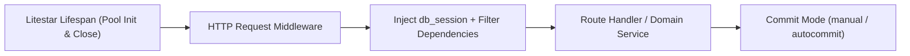

# Litestar Integration

`sqlspec.extensions.litestar` provides `SQLSpecPlugin`, wiring SQLSpec connection pools into Litestar's application lifespan, registering request-scoped session and connection dependencies, mounting `litestar db` / `litestar database` and `litestar sessions delete-expired` CLI commands, providing declarative query filter dependencies, and supplying server-side Litestar `Store` and `ChannelsBackend` implementations across supported database adapters.

## Installation

=== "uv"

    ```bash
    uv add "sqlspec[litestar]"
    ```

=== "pip"

    ```bash
    pip install "sqlspec[litestar]"
    ```

=== "pdm"

    ```bash
    pdm add "sqlspec[litestar]"
    ```

=== "poetry"

    ```bash
    poetry add "sqlspec[litestar]"
    ```

## Plugin Setup and Session Injection



Pass a single database configuration, a sequence of configurations, or a `SQLSpec` registry to `SQLSpecPlugin` and register it in `Litestar(plugins=[...])`:

```python
--8<-- "docs/examples/extensions/litestar/plugin_setup.py:example"
```

By default, a single configuration registers `db_session`, `db_connection`, and `db_pool` in Litestar's dependency graph, and `plugin.get_config()` returns that configuration. Override `session_key`, `connection_key`, or `pool_key` inside `extension_config["litestar"]` to customize parameter names.

## Configuration Options

Configure `extension_config["litestar"]` (`LitestarConfig`) per database configuration:

<!-- GENERATED:START config-table:sqlspec.config.LitestarConfig -->
| Key | Type | Default | Description |
| --- | --- | --- | --- |
| `tenant_extractor` | `Callable[[MutableMapping[str, Any]], Any]` | - | Trusted scope callable returning a tenant identity, payload, None (no tenant from this source), or an awaitable. Requires tenant_strategy on the same configuration; called on first tenant use, never at request start. |
| `tenant_user_attr` | `str` | `'tenant_id'` | Verified direct tenant attribute or mapping key. Default: 'tenant_id'. |
| `tenant_memberships_attr` | `str` | `'tenant_ids'` | Verified membership attribute or mapping key. Default: 'tenant_ids'. |
| `tenant_variables_attr` | `str` | `'tenant_variables'` | Extra session variables attribute or mapping key. Default: 'tenant_variables'. |
| `tenant_jwt_claim` | `str` | `'tenant_id'` | Direct tenant key in verified auth claims or extras. Default: 'tenant_id'. |
| `tenant_path_parameter` | `str or None` | `'tenant_id'` | Route parameter checked against verified memberships. Default: 'tenant_id'. |
| `tenant_session_key` | `str or None` | `'tenant_id'` | Session selector checked against verified memberships. Default: 'tenant_id'. |
| `tenant_header` | `str or None` | `None` | Optional header selector checked against verified memberships. Default: None. |
| `migrations_path` | `str or Path` | - | Directory containing this extension's migrations, or a `'<dotted.module>:<subdir>'` specification. Overrides the default `sqlspec.extensions.<name>` lookup. Setting this auto-includes the extension in `migration_config["include_extensions"]`. |
| `session_table` | `bool or str` | - | Enable session table for server-side session storage. `True`: Use default table name ('litestar_session'); `"custom_name"`: Use custom table name. When set, litestar extension migrations are auto-included to create the session table. If you're only using litestar for DI/connection management (not session storage), leave this unset to skip the migrations. |
| `connection_key` | `str` | `'db_connection'` | Key for storing connection in ASGI scope. Default: 'db_connection' |
| `pool_key` | `str` | `'db_pool'` | Key for storing connection pool in application state. Default: 'db_pool' |
| `session_key` | `str` | `'db_session'` | Key for storing session in ASGI scope. Default: 'db_session' |
| `commit_mode` | `Literal['manual', 'autocommit', 'autocommit_include_redirect']` | `'autocommit'` | Transaction commit mode. Default: 'autocommit' |
| `enable_correlation_middleware` | `bool` | `True` | Enable request correlation ID middleware. Default: True |
| `correlation_header` | `str` | `X-Request-ID` | HTTP header to read the request correlation ID from when middleware is enabled. Default: `X-Request-ID` |
| `correlation_headers` | `tuple[str, ...] or list[str]` | - | Additional HTTP headers to read as correlation ID fallbacks. |
| `auto_trace_headers` | `bool` | `True` | Read standard trace context headers as correlation ID fallbacks. Default: True. |
| `extra_commit_statuses` | `set[int]` | `set()` | Additional HTTP status codes that trigger commit. Default: set() |
| `extra_rollback_statuses` | `set[int]` | `set()` | Additional HTTP status codes that trigger rollback. Default: set() |
| `disable_di` | `bool` | `False` | Disable built-in dependency injection. Default: False. When True, the Litestar plugin will not register dependency providers for database connections, pools, and sessions, or the per-request handler that commits and closes request connections. Pool startup and shutdown follow `manage_lifespan`, which defaults to False when `disable_di` is True. |
| `manage_lifespan` | `bool` | - | Register the plugin's pool lifespan handler. Default: the inverse of `disable_di`. When True, the Litestar plugin creates the configuration's pool on application startup, stores it in application state under `pool_key`, and closes it on shutdown, whether or not `disable_di` is set. Set to True alongside `disable_di=True` to keep pool lifecycle management while another DI solution provides connections and sessions. When False, the application creates and closes the pool itself; with dependency injection enabled, the plugin's providers still read the pool from application state under `pool_key`. |
| `enable_sqlcommenter_middleware` | `bool` | `True` | Control automatic SQLCommenter middleware registration. Default: True. When the driver's :class:`~sqlspec.core.statement.StatementConfig` has `enable_sqlcommenter=True`, the middleware is registered automatically. Set to `False` to explicitly disable middleware registration even when SQLCommenter is enabled on the driver config. |
| `manage_schema` | `bool` | `True` | Apply additive session-table reconciliation. Default: True. |
| `create_schema` | `bool` | `True` | Create a missing session table during managed reconciliation. Default: True. |
| `migration_mode` | `ExtensionMigrationMode` | `'reconcile'` | Extension migration strategy (`'versioned'` or `'reconcile'`). Default: `'reconcile'`. |
| `read_session_key` | `str` | - | Request key for a read session. |
| `read_connection_key` | `str` | - | Request key for a read connection. |
| `routing_session_key` | `str` | - | Request key for a routing session. |
| `default_routing_mode` | `Literal['primary', 'auto']` | `'auto'` | Default request routing mode. Default: `'auto'`. |
| `enable_routing_middleware` | `bool` | `True` | Install request-scoped routing middleware. Default: True. |
| `routing_header` | `str or None` | `None` | Trusted application routing header name when explicitly enabled behind a gateway. Default: None. |
| `write_pin_cookie` | `str or None` | `None` | Optional application write-pin cookie name. Default: None. |
| `routing_secret` | `str or bytes or None` | `None` | Optional HMAC secret verifying signed write-pin cookies. Default: None. |
| `read_pool_key` | `str` | - | Request key for the selected read pool. |
| `cursor_secret` | `str or bytes` | - | Application-wide secret enabling HMAC-SHA256 signed pagination cursors. |
| `cursor_ttl` | `int or float or dt.timedelta` | - | Default cursor expiration window in seconds or timedelta. |
| `cursor_encrypt` | `bool` | - | Encrypt cursor payloads at rest when a cursor secret is configured. |
<!-- GENERATED:END config-table:sqlspec.config.LitestarConfig -->

## Multi-Database Dependency Keys

When an application connects to multiple databases (for example, a transactional primary database and a read-heavy analytics database), pass the list of configurations to `SQLSpecPlugin([...])` with a distinct `bind_key` and `session_key` on each configuration:

```python
--8<-- "docs/examples/extensions/litestar/dependency_keys.py:example"
```

## On-Demand Session and Connection Acquisition

In custom guards, middleware, streaming iterators, or event hooks where standard route dependency injection is not active, `SQLSpecPlugin` exposes direct scope-backed session and connection accessors. `ConnectionCleanupMiddleware` stays outer to application middleware so inner `before_send` hooks evaluate `commit_mode` on `http.response.start` and release non-streaming HTTP responses on the terminal `http.response.body` (`more_body=False`) (or immediately on `http.response.start` if finalization raises), while streaming responses (`more_body=True`, `Stream` responses, or connections acquired after `http.response.start`) defer cleanup to `ConnectionCleanupMiddleware` when the ASGI request completes or cancels. Once released, the request session detaches its underlying connection and raises `ImproperConfigurationError` if accessed after teardown:

- `plugin.provide_request_session(key, state, scope)` and `plugin.provide_request_connection(key, state, scope)` (when the connection already exists in ASGI scope). For an async configuration whose connection is not open yet, `provide_request_session` returns a session that acquires it on the first awaited call, with the same tenant resolution and commit handling as `provide_request_session_async`; `provide_request_connection` raises `ImproperConfigurationError` naming the async accessor.
- `plugin.provide_request_session_sync(key, state, scope)` and `plugin.provide_request_connection_sync(key, state, scope)` (acquires a sync connection on demand if not yet present in `scope`; async configurations behave as `provide_request_session` and `provide_request_connection`).
- `await plugin.provide_request_session_async(key, state, scope)` and `await plugin.provide_request_connection_async(key, state, scope)` (acquires an async connection on demand if not yet present in `scope`).

## Tenant-Aware Requests

With `driver_features={"tenant_strategy": "rls"}` on a supported adapter, injected `db_session` and `db_connection` dependencies and `guards=[require_tenant()]` resolve the request tenant from verified authentication state, using the selector and user attribute names set once in `extension_config["litestar"]`. Mark public routes with `opt={"tenant_bypass": True}`. See [Litestar Multi-Tenancy](../learn/recipes/multi-tenancy-litestar.md) for JWT, server-side session, separate auth database, and `litestar-security` examples, and the [Tenant Request Contract](../learn/recipes/multi-tenancy-frameworks.md#one-request-contract) for the rules every framework shares.

#### Reader and routing dependencies

A config with replicas exposes `read_session`, `read_connection`, and `read_pool`. Rename them with `read_session_key`, `read_connection_key`, and `read_pool_key`. Set `routing_session_key` to opt into a routing session. A reader opens on first use. It does not open a primary session first.

For direct access, use `get_read_session(request)` or `provide_request_read_session` and its `_sync`/`_async` forms. The `provide_request_routing_session*` helpers return routing sessions. Read connection helpers use the same names with `connection` in place of `session`. Pass a config or bind key to choose the database.

Tenant middleware binds the captured `TenantContextPayload` around each physical checkout, including readers. `SQLSpecRoutingMiddleware` scopes primary pins and reads stateless hints. Check tenant access in the normal request path. See [Read Replicas](../learn/recipes/read-replicas.md) for fallback and freshness choices.

## Automatic HTTP 404 and 409 Exception Mapping

During `SQLSpecPlugin.on_app_init`, the plugin registers two default exception handlers unless your application already defines custom handlers for those exception types:

- `not_found_error_handler`: Maps `sqlspec.exceptions.NotFoundError` (such as `select_one` returning zero rows) to an HTTP `404 NotFoundException` response.
- `integrity_error_handler`: Maps `sqlspec.exceptions.IntegrityError` (including `UniqueViolationError`, `ForeignKeyViolationError`, and `CheckViolationError`) to an HTTP `409 Conflict` response.

## Transaction Commit Modes

Configure `commit_mode` inside `extension_config["litestar"]` to control how request-scoped sessions finalize when a route handler returns:

| Commit Mode | Commits On | Rolls Back On | Best For |
| --- | --- | --- | --- |
| `"autocommit"` (default) | Clean HTTP `200`–`299` responses | HTTP `>= 300` responses (`3xx`, `4xx`, `5xx`), any raised exception (including mapped `2xx` responses), or cancellation | JSON REST APIs where every `2xx` handler mutates state |
| `"autocommit_include_redirect"` | Clean HTTP `200`–`399` responses | HTTP `>= 400` responses, any raised exception (including mapped `2xx`/`3xx` responses), or cancellation | HTML, HTMX, and Inertia.js form handlers that commit and return `302` / `303` redirects |
| `"manual"` | Explicit `session.commit()` calls only | Uncommitted handler work on clean return, unhandled or mapped exceptions, and request cancellations | Explicit service-layer transaction boundaries |

```python
--8<-- "docs/examples/frameworks/litestar/commit_modes.py:example"
```

Add `extra_commit_statuses` or `extra_rollback_statuses` in `LitestarConfig` when `"autocommit"` or `"autocommit_include_redirect"` requires custom commit or rollback status overrides.

On `adbc`, `arrow_odbc`, `asyncpg`, `cockroach_asyncpg`, `db2`, `duckdb`, `psqlpy`, `snowflake`, `sybase`, and `teradata`, requests running under `"manual"`, `"autocommit"`, or `"autocommit_include_redirect"` open their transaction lazily on the first write statement rather than issuing an eager `BEGIN` at request start, eliminating extra transaction round trips on read-only handlers.

## Request Failure Handling

Litestar manages request connections across two distinct paths, and both forward exceptions and cancellations to the adapter's connection context exit (`__aexit__`):

- **Injected dependencies (`db_session` / `db_connection`)**: The dependency generator owns the connection context while the route handler executes. If the handler raises `BaseException`, the generator exits the connection context immediately with `(exc_type, exc_val, exc_tb)` before Litestar renders an exception response. When an HTTP handler returns normally before `http.response.start`, the generator hands the open context to ASGI scope so inner `before_send` applies `commit_mode` against the response status and exits the context immediately for non-streaming responses, deferring streaming responses (`Stream`) until the stream completes or cancels in the outer `ConnectionCleanupMiddleware`. If `asyncio.CancelledError` or an error in `after_request`, response serialization, or an exception handler aborts the request before `http.response.start`, `ConnectionCleanupMiddleware` rolls back uncommitted work and exits the context. After finalization, the detached session raises `ImproperConfigurationError` on further queries instead of reading a returned pool connection.
- **On-demand accessors (`provide_request_session_*` / `provide_request_connection_*`)**: Connections live directly in ASGI scope. Whenever a handler or hook raises an exception, Litestar's `after_exception` hook runs `record_request_exception` to store the exception in scope before sending the error response. Both `before_send` (under `autocommit` and `manual` modes) and `ConnectionCleanupMiddleware` check this recorded exception before inspecting HTTP status codes, rolling back uncommitted writes and passing `(exc_type, exc_val, exc_tb)` to `__aexit__`.

Both unhandled exceptions and exceptions mapped to HTTP responses by Litestar `exception_handlers` (such as `HTTPException`, `NotFoundError`, `IntegrityError`, or custom handlers returning `4xx` or `2xx` fallback responses) record the exception via `after_exception` and roll back uncommitted work. By contrast, Starlette, FastAPI, and Flask treat exceptions already converted into responses by inner framework exception handlers as normal responses at the middleware boundary unless status-based rollback applies.

In `"manual"` mode, uncommitted handler writes roll back consistently before releasing the connection back to the pool (only adapters without session-level multi-statement transactions—such as `bigquery` outside explicit session transactions and non-transactional `spanner` snapshots—are outside DB-API session rollback).

## Declarative Query Filter Providers

Use `create_filter_dependencies` with `FilterConfig` to generate OpenAPI-documented Litestar dependencies that parse query parameters directly into `StatementFilter` lists (`LimitOffsetFilter`, `OrderByFilter`, `SearchFilter`, `BeforeAfterFilter`, `CursorFilter`, and `InCollectionFilter`):

```python
from datetime import datetime
from typing import Annotated, Any
from uuid import UUID

from litestar import Litestar, get
from litestar.params import Dependency

from sqlspec.adapters.asyncpg import AsyncpgDriver
from sqlspec.core import FilterTypes
from sqlspec.extensions.litestar.providers import (
    FilterConfig,
    create_filter_dependencies,
)

user_filters = create_filter_dependencies(
    FilterConfig(
        id_filter=UUID,
        id_field="id",
        sort_field="created_at",
        sort_order="desc",
        pagination_type="limit_offset",
        pagination_size=25,
        pagination_max_size=100,
        search="name,email",
        search_ignore_case=True,
        created_at=True,
        updated_at=True,
    )
)


@get("/users", dependencies=user_filters)
async def list_users(
    db_session: AsyncpgDriver,
    filters: Annotated[list[FilterTypes], Dependency(skip_validation=True)],
) -> list[dict[str, Any]]:
    return await db_session.select(
        "SELECT id, name, email, created_at FROM users", *filters
    )
```

For bidirectional keyset pagination (`CursorPagination`), set `pagination_type="cursor"` and `cursor_keys="id"` (or pass `CursorKey` specs) on `FilterConfig`; see [Filtering and Pagination](../learn/filtering-and-pagination.md). Configure application-wide cursor signing (`cursor_secret`), expiration (`cursor_ttl`), and payload encryption (`cursor_encrypt`) once via `LitestarConfig` or `SQLSpecPlugin(..., cursor_secret=..., cursor_ttl=..., cursor_encrypt=...)` (falling back to `SQLSPEC_CURSOR_SECRET` / `SECRET_KEY` environment variables when omitted); `create_filter_dependencies(...)` inherits those settings from application state automatically and derives per-endpoint signing keys without duplicating configuration per controller.

## Server-Side Session Stores

Supported database adapters export a Litestar `Store` implementation under `sqlspec.adapters.<adapter>.litestar` (for example, `AiosqliteStore`, `AsyncpgStore`, `OracleAsyncStore`, or `SpannerAsyncStore`; see the [Database Capability Matrix](../databases/index.md) for per-adapter store support):

```python
--8<-- "docs/examples/frameworks/litestar/session_stores.py:example"
```

Call `await store.create_table()` during application startup (or configure `session_table=True` in `extension_config["litestar"]`, which auto-includes the `litestar_session` table in migrations) and pass the store to Litestar's `ServerSideSessionConfig` or `stores={"sessions": store}` registry.

While a request holds an open database session for the store's configuration, the store runs on that session's connection and does not take a second one, so a one-connection pool cannot deadlock on its own session writes. Session changes belong to the request's transaction: they commit with a successful request and roll back with a failed one, or with a manual-mode request that never commits. A store call made outside a request, such as from startup code, a CLI command, or a background task, opens its own short session and commits itself. Stores bound to a different configuration also open their own session. No extra configuration is needed.

SQL Server, Oracle, and Arrow ODBC session stores accept schema-qualified `session_table` names (such as `"auth.litestar_session"`, `"[auth].[litestar_session]"`, or `"APP.litestar_session"`). The schema must already exist.

`session_table` (`True` or a custom table name) is still required to include Litestar session migrations (`migration_mode="reconcile"` is the default). Reconciliation converges the session table on every `litestar db upgrade` or `sqlspec upgrade` without recording new `ext_litestar_*` rows, preserves the table during partial downgrades, and drops it when `downgrade` reaches `base` while honoring `manage_schema` and `create_schema` (see [Migrations](../learn/migrations.md)):

```python
extension_config = {
    "litestar": {
        "session_table": True,
        "migration_mode": "reconcile",
    }
}
```

| Adapter Family | Built-In Adapters | Reconcile Scope and Boundaries |
| --- | --- | --- |
| Embedded, OLTP, and Enterprise | `sqlite`, `aiosqlite`, `asyncpg`, `psycopg`, `psqlpy`, `cockroach_asyncpg`, `cockroach_psycopg`, `aiomysql`, `asyncmy`, `pymysql`, `mysqlconnector`, `duckdb`, `mssql_python`, `pymssql`, `oracledb`, `db2`, `sqlanywhere`, `sybase`, `teradata` | Creates missing session tables, adds safe missing nullable or defaulted columns, and converges the companion `expires_at` index (`dbo`-defaulted or schema-qualified on SQL Server and validated schema-qualified on Oracle). |
| Arrow ODBC | `arrow_odbc` (`mssql`, `tsql`, `db2`) | Converges compound primary session and `<table_name>_chunks` tables and their companion expiry and chunk indexes across SQL Server and Db2 targets. |
| Cloud Spanner and BigQuery | `spanner`, `bigquery` | Converges `litestar_session` tables and companion expiry indexes (`spanner` TTL/index DDL; `bigquery` nullable-only additive column repair on existing tables, refusing `NOT NULL` or defaulted column additions with `MigrationError`). |
| Multi-backend ADBC | `adbc` | Converges session tables and companion expiry indexes across all ADBC backends with a resolved dialect. ADBC over FlightSQL needs an explicit `statement_config` dialect or `gizmosql_backend`. |

### Litestar Channels Backend

`SQLSpecChannelsBackend` implements Litestar's `ChannelsBackend` on top of `plugin.sqlspec.event_channel(config)`, allowing `ChannelsPlugin` to broadcast WebSocket and SSE messages through PostgreSQL `LISTEN`/`NOTIFY`, hybrid `notify_queue`, Oracle AQ, or portable `poll_queue` tables without a separate Redis broker:

```python
from litestar import Litestar
from litestar.channels import ChannelsPlugin
from sqlspec.adapters.asyncpg import AsyncpgConfig
from sqlspec.extensions.litestar import SQLSpecChannelsBackend, SQLSpecPlugin

config = AsyncpgConfig(
    connection_config={"dsn": "postgresql://localhost/app"},
    extension_config={"events": {"backend": "notify_queue"}},
)
plugin = SQLSpecPlugin(config)
channels_backend = SQLSpecChannelsBackend(
    plugin.sqlspec.event_channel(config),
    channel_prefix="litestar",
    poll_interval=0.2,
)
app = Litestar(
    plugins=[
        plugin,
        ChannelsPlugin(backend=channels_backend, channels=["notifications"]),
    ]
)
```

**Litestar CLI Commands** — Registering `SQLSpecPlugin` mounts SQLSpec's migration commands under `litestar db` (aliased as `litestar database`) and adds a `delete-expired` maintenance command under Litestar's `sessions` CLI group:

```bash
litestar db show-current-revision
litestar db upgrade
litestar sessions delete-expired --verbose
```

## Production Litestar and Dishka Architecture

In enterprise microservices, teams often combine Litestar's HTTP routing, OpenAPI documentation, and lifecycle management with Dishka's unified dependency container. To prevent conflicting dependency injection providers while allowing Litestar to manage database pool startup and teardown, configure `SQLSpecPlugin` with `disable_di=True` and `manage_lifespan=True`:

```python
from collections.abc import AsyncIterator

import msgspec
from dishka import Provider, Scope, make_async_container, provide
from dishka.integrations.litestar import FromDishka, inject, setup_dishka
from litestar import Controller, Litestar, get

from sqlspec.adapters.asyncpg import AsyncpgConfig, AsyncpgDriver
from sqlspec.extensions.litestar import SQLSpecPlugin


class Account(msgspec.Struct):
    id: int
    name: str


class DatabaseProvider(Provider):
    """Provide request-scoped drivers from the shared database configuration."""

    def __init__(self, config: AsyncpgConfig) -> None:
        super().__init__()
        self._config = config

    @provide(scope=Scope.REQUEST)
    async def provide_driver(self) -> AsyncIterator[AsyncpgDriver]:
        async with self._config.provide_session() as session:
            yield session


class AccountController(Controller):
    path = "/accounts"

    @get("/{account_id:int}")
    @inject
    async def get_account(
        self, account_id: int, driver: FromDishka[AsyncpgDriver]
    ) -> Account:
        return await driver.select_one(
            "SELECT id, name FROM accounts WHERE id = :id",
            id=account_id,
            schema_type=Account,
        )


def create_app() -> Litestar:
    config = AsyncpgConfig(
        connection_config={"dsn": "postgresql://localhost/app"},
        extension_config={
            "litestar": {"disable_di": True, "manage_lifespan": True}
        },
    )
    container = make_async_container(DatabaseProvider(config))
    app = Litestar(
        route_handlers=[AccountController],
        plugins=[SQLSpecPlugin(config)],
    )
    setup_dishka(container, app)
    return app
```

Create the `AsyncpgConfig` once and pass that same instance to both `SQLSpecPlugin(config)` and `DatabaseProvider(config)` so Dishka sessions draw from the pool managed by Litestar's lifespan.

## Connection Lifetime

- **Normal responses**: The request connection is committed or rolled back when the response starts and released after the final body frame.
- **Streaming responses**: The connection stays held until the stream finishes or the client disconnects, so the request session works inside a `Stream` body.
- **Background work**: A background task runs after the connection is released. Open a new session with `config.provide_session()` inside the task.

A session or stream cannot be used after its connection is released; trying to raises `ImproperConfigurationError`.

## Recap

- `SQLSpecPlugin` manages pool lifecycles, injects `db_session` / `db_connection` / `db_pool`, maps `NotFoundError` (`404`) and `IntegrityError` (`409`), and registers `litestar db` and `litestar sessions delete-expired` CLI commands automatically.
- Set `commit_mode`, `session_key`, `enable_correlation_middleware`, and `enable_sqlcommenter_middleware` in `extension_config["litestar"]` (`LitestarConfig`).
- When integrating with Dishka, set `disable_di=True` and `manage_lifespan=True` on `extension_config["litestar"]`.
- See the [Litestar Extension Reference](/reference/extensions/litestar/) for `SQLSpecPlugin`, `SQLSpecChannelsBackend`, `LitestarConfig`, and `FilterConfig` signatures.
