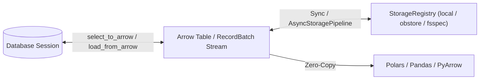

# Arrow and Storage

SQLSpec bridges relational and analytical workloads with first-class **Apache Arrow** query results (`select_to_arrow`), streaming `RecordBatch` pipelines (`read_arrow_batches` / `write_arrow_batches`), pluggable object storage (`StorageRegistry` over local paths, `obstore`, and `fsspec`), multi-shard bulk ingestion, and schema-aware JSONL table fixtures.



## Querying Directly to Apache Arrow, Polars, and Pandas

Call `session.select_to_arrow(...)` (`await session.select_to_arrow(...)` on async drivers) to return an `ArrowResult` wrapping a `pyarrow.Table` or streaming `RecordBatchReader`:

```python
from sqlspec import SQLSpec
from sqlspec.adapters.sqlite import SqliteConfig

spec = SQLSpec()
config = spec.add_config(
    SqliteConfig(connection_config={"database": ":memory:"})
)

with spec.provide_session(config) as session:
    session.execute("CREATE TABLE metrics (host TEXT, cpu_pct REAL)")
    session.execute_many(
        "INSERT INTO metrics VALUES (?, ?)", [("web-1", 41.5), ("web-2", 68.0)]
    )

    arrow_result = session.select_to_arrow(
        "SELECT host, cpu_pct FROM metrics ORDER BY host"
    )
    arrow_table = arrow_result.data
```

Adapters with native columnar wire protocols—including **DuckDB**, **ADBC**, **Arrow ODBC**, **BigQuery** (Storage Read API), and **Oracle 23ai/26ai** (zero-copy PyCapsule `fetch_df_all` / `fetch_df_batches`)—transfer Arrow buffers without materializing intermediate Python row dictionaries. Other DB-API adapters convert rows automatically using schema-guided Arrow builders when `native_only=False` (the default).

Convert an `ArrowResult` to DataFrame libraries in one call:

- `arrow_result.data`: Underlying `pyarrow.Table` (when `return_format="table"`) or `RecordBatchReader` (`return_format="batches"`).
- `arrow_result.to_polars()`: Converts to a `polars.DataFrame` (`uv add "sqlspec[polars]"`).
- `arrow_result.to_pandas()`: Converts to a `pandas.DataFrame` (`uv add "sqlspec[pandas]"`).

## Unified Object Storage (`StorageRegistry`)

`storage_registry` resolves local paths and cloud URIs (`s3://`, `gs://`, `az://`, `file://`) behind a consistent `ObjectStoreProtocol` backed by `local`, `obstore` (`uv add "sqlspec[obstore]"`), or `fsspec` (`uv add "sqlspec[fsspec]"`):

```python
from pathlib import Path
import tempfile

from sqlspec.storage import SyncStoragePipeline, storage_registry

with tempfile.TemporaryDirectory() as tmp_dir:
    archive_dir = Path(tmp_dir)
    storage_registry.register_alias(
        "exports", archive_dir.as_uri(), backend="local"
    )

    pipeline = SyncStoragePipeline(registry=storage_registry)
    pipeline.write_rows(
        [
            {"host": "web-1", "cpu_pct": 41.5},
            {"host": "web-2", "cpu_pct": 68.0},
        ],
        "alias://exports/metrics.parquet",
        format="parquet",
    )
    table = pipeline.read_arrow(
        "alias://exports/metrics.parquet", file_format="parquet"
    )
```

You can also write an `ArrowResult` directly to any storage destination via `arrow_result.write_to_storage_sync("alias://exports/metrics.parquet")` (or `await arrow_result.write_to_storage_async(...)`). On Windows environments where `obstore` is installed alongside local filesystem paths, pass `backend="local"` when registering local directory aliases so Windows drive prefixes resolve cleanly.

### Streaming `RecordBatch` Coercion & Schema Validation

For datasets larger than available RAM, `SyncStoragePipeline` and `AsyncStoragePipeline` expose `read_arrow_batches(...)` and `write_arrow_batches(...)` alongside `coerce_arrow_batches(...)` and `validate_arrow_schema(...)` from `sqlspec.utils.arrow_helpers`:

- **Bounded-Memory Streaming**: `read_arrow_batches` yields `pyarrow.RecordBatch` chunks lazily from Parquet, Arrow IPC, or JSONL sources without materializing a full `pyarrow.Table`.
- **Single-Pass Target Schema Coercion**: When `target_schema` (or target table `ColumnMetadata`) is supplied to `load_from_arrow` or `load_from_storage`, SQLSpec validates and coerces incoming batches (`DECIMAL`, `TIMESTAMP`, `UUID`, binary, and `FIXED_SIZE_LIST` vector columns) one `RecordBatch` at a time before streaming to the database driver.

## Schema-Aware Table Fixtures (`.jsonl` / `.json.gz`)

`sqlspec.utils.fixtures` exports and loads per-table `.json`, `.json.gz`, `.jsonl`, and `.jsonl.gz` files while introspecting live column types (`UUID`, ISO timestamps, `Decimal`, base64 `bytes`, `JSON`/`JSONB`, identity columns, and sequence resyncing) via `driver.data_dictionary`:

```python
from pathlib import Path
import tempfile

from sqlspec import SQLSpec
from sqlspec.adapters.sqlite import SqliteConfig
from sqlspec.utils.fixtures import (
    export_table_fixtures_sync,
    load_table_fixtures_sync,
)

spec = SQLSpec()
config = spec.add_config(
    SqliteConfig(connection_config={"database": ":memory:"})
)

with (
    tempfile.TemporaryDirectory() as tmp_dir,
    spec.provide_session(config) as session,
):
    fixtures_dir = Path(tmp_dir)
    session.execute(
        "CREATE TABLE roles (id INTEGER PRIMARY KEY, slug TEXT UNIQUE)"
    )
    session.execute("INSERT INTO roles (slug) VALUES ('admin'), ('reader')")

    export_table_fixtures_sync(
        session, fixtures_dir, ["roles"], jsonl=True, compress=False
    )
    counts = load_table_fixtures_sync(
        session,
        fixtures_dir,
        tables=["roles"],
        conflict_keys={"roles": "slug"},
        exclude_update_columns={"roles": ["id"]},
    )
```

## Recap

- Use `select_to_arrow` whenever feeding `pyarrow`, `polars`, `pandas`, or Parquet pipelines.
- Register named storage buckets on `storage_registry` (`s3://`, `gs://`, `az://`, or `backend="local"`) so application code addresses portable `alias://...` destinations.
- Use `export_table_fixtures_*` and `load_table_fixtures_*` with `conflict_keys` and `exclude_update_columns` for idempotent seed data and test fixtures.
