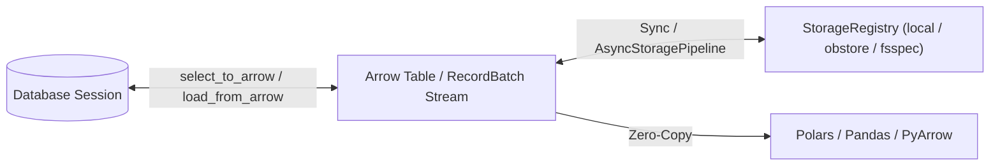

# Arrow and Storage

SQLSpec bridges relational and analytical workloads with first-class **Apache Arrow** query results (`select_to_arrow`), bulk ingestion from Arrow tables, object storage, and Python records (`load_from_arrow`, `load_from_storage`, `load_from_records`), streaming `RecordBatch` pipelines (`read_arrow_batches` / `write_arrow_batches`), pluggable object storage (`StorageRegistry` over local paths, `obstore`, and `fsspec`), and schema-aware JSONL table fixtures.



## Querying Directly to Apache Arrow, Polars, and Pandas

Call `session.select_to_arrow(...)` (or `session.fetch_to_arrow(...)`; `await` on async drivers) to return an `ArrowResult` wrapping a `pyarrow.Table` or streaming `RecordBatchReader`:

```python
from sqlspec import SQLSpec
from sqlspec.adapters.sqlite import SqliteConfig

spec = SQLSpec()
config = spec.add_config(
    SqliteConfig(connection_config={"database": ":memory:"})
)

with spec.provide_session(config) as session:
    session.execute("CREATE TABLE metrics (host TEXT, cpu_pct REAL)")
    session.execute_many(
        "INSERT INTO metrics VALUES (?, ?)", [("web-1", 41.5), ("web-2", 68.0)]
    )

    arrow_result = session.select_to_arrow(
        "SELECT host, cpu_pct FROM metrics ORDER BY host"
    )
    arrow_table = arrow_result.data
```

Adapters with native Arrow support include DuckDB, ADBC, Arrow ODBC, BigQuery's Storage Read API, and Oracle's DataFrame APIs. These paths avoid intermediate Python row dictionaries. Other DB-API adapters convert rows when `native_only=False` (the default).

Convert an `ArrowResult` to DataFrame libraries in one call:

- `arrow_result.data`: Underlying `pyarrow.Table` (when `return_format="table"`) or `RecordBatchReader` (`return_format="reader"`).
- `arrow_result.to_polars()`: Converts to a `polars.DataFrame` (`uv add "sqlspec[polars]"`).
- `arrow_result.to_pandas()`: Converts to a `pandas.DataFrame` (`uv add "sqlspec[pandas]"`).

### Empty Results and Explicit Schemas

Row-based drivers keep column names when a query has no rows. Without adapter type hints, each empty column has the Arrow `null` type. Set `arrow_schema=` to choose each column's type. Install PyArrow with `uv add pyarrow` before running this standalone example:

```python
--8<-- "docs/examples/querying/empty_arrow_schema.py:example"
```

The result has zero rows and the schema `host: string, cpu_pct: double`. Empty `table`, `batch`, and `reader` results retain this schema. Empty `batches` results are an empty list, so they cannot carry a schema.

## Bulk Loading from Arrow, Storage, and Python Records

Every sync and async driver exposes three symmetric bulk-ingestion entry points that route through the adapter's fastest native bulk path (`PGCOPY` on PostgreSQL, `BulkCopy` on SQL Server, Arrow C-stream registration on DuckDB/ADBC, `DBMS_CLOUD` on Oracle, and staged upserts across dialects) and return a `StorageBridgeJob`:

- `session.load_from_arrow(table, arrow_data, ...)`: Ingests a `pyarrow.Table`, `RecordBatch`, or `RecordBatchReader` into `table`.
- `session.load_from_storage(table, source, ...)`: Streams Parquet, Arrow IPC, CSV, or JSONL shards (including glob patterns like `"s3://bucket/events/*.parquet"`) into `table`.
- `session.load_from_records(table, records, ...)`: Normalizes a sequence of Python dictionaries or tuples into an Arrow table (inferring or applying `arrow_schema` / target table metadata) and delegates to `load_from_arrow`:

```python
import pyarrow as pa
from sqlspec import SQLSpec
from sqlspec.adapters.sqlite import SqliteConfig

spec = SQLSpec()
config = spec.add_config(
    SqliteConfig(connection_config={"database": ":memory:"})
)

with spec.provide_session(config) as session:
    session.execute(
        "CREATE TABLE metrics (host TEXT PRIMARY KEY, cpu_pct REAL)"
    )
    job = session.load_from_records(
        "metrics",
        [{"host": "web-1", "cpu_pct": 41.5}, {"host": "web-2", "cpu_pct": 68.0}],
        conflict_keys=["host"],
    )
    arrow_batch = pa.table({"host": ["web-1"], "cpu_pct": [52.0]})
    upsert_job = session.load_from_arrow(
        "metrics", arrow_batch, conflict_keys=["host"]
    )
```

## Unified Object Storage and StorageRegistry

`storage_registry` resolves local paths and cloud URIs (`s3://`, `gs://`, `az://`, `file://`) behind a consistent `ObjectStoreProtocol` backed by `local`, `obstore` (`uv add "sqlspec[obstore]"`), or `fsspec` (`uv add "sqlspec[fsspec]"`). In `SyncStoragePipeline` and `AsyncStoragePipeline`, use `write_rows(..., format_hint="jsonl")` for row dictionaries (`"json"` or `"jsonl"`), `write_arrow(..., format_hint="parquet")` for columnar Arrow tables (`"parquet"`, `"arrow-ipc"`, or `"csv"`), and unpack `table, telemetry = pipeline.read_arrow(...)`:

```python
from pathlib import Path
import tempfile
import pyarrow as pa

from sqlspec.storage import SyncStoragePipeline, storage_registry

with tempfile.TemporaryDirectory() as tmp_dir:
    archive_dir = Path(tmp_dir)
    storage_registry.register_alias(
        "exports", archive_dir.as_uri(), backend="local"
    )

    pipeline = SyncStoragePipeline(registry=storage_registry)
    rows = [
        {"host": "web-1", "cpu_pct": 41.5},
        {"host": "web-2", "cpu_pct": 68.0},
    ]
    pipeline.write_rows(
        rows, "alias://exports/metrics.jsonl", format_hint="jsonl"
    )
    arrow_table = pa.Table.from_pylist(rows)
    pipeline.write_arrow(
        arrow_table,
        "alias://exports/metrics.parquet",
        format_hint="parquet",
    )
    table, telemetry = pipeline.read_arrow(
        "alias://exports/metrics.parquet", file_format="parquet"
    )
```

You can also write an `ArrowResult` directly to any storage destination via `arrow_result.write_to_storage_sync("alias://exports/metrics.parquet")` (or `await arrow_result.write_to_storage_async(...)`). On Windows environments where `obstore` is installed alongside local filesystem paths, pass `backend="local"` when registering local directory aliases so Windows drive prefixes resolve cleanly.

### Streaming RecordBatch Coercion and Schema Validation

For datasets larger than available RAM, `SyncStoragePipeline` and `AsyncStoragePipeline` expose `read_arrow_batches(...)` and `write_arrow_batches(...)` alongside `coerce_arrow_batches(...)` and `validate_arrow_schema(...)` from `sqlspec.utils.arrow_helpers`:

- **Bounded-Memory Streaming**: `read_arrow_batches` yields `pyarrow.RecordBatch` chunks lazily from Parquet, Arrow IPC, or JSONL sources without materializing a full `pyarrow.Table`.
- **Single-Pass Target Schema Coercion**: When `target_schema` (or target table `ColumnMetadata`) is supplied to `load_from_arrow` or `load_from_storage`, SQLSpec validates and coerces incoming batches (`DECIMAL`, `TIMESTAMP`, `UUID`, binary, and `FIXED_SIZE_LIST` vector columns) one `RecordBatch` at a time before streaming to the database driver.

## Schema-Aware Table Fixtures

`sqlspec.utils.fixtures` exports and loads per-table `.json`, `.json.gz`, `.jsonl`, and `.jsonl.gz` files while introspecting live column types (`UUID`, ISO timestamps, `Decimal`, base64 `bytes`, `JSON`/`JSONB`, identity columns, and sequence resyncing) via `driver.data_dictionary`:

```python
from pathlib import Path
import tempfile

from sqlspec import SQLSpec
from sqlspec.adapters.sqlite import SqliteConfig
from sqlspec.utils.fixtures import (
    export_table_fixtures_sync,
    load_table_fixtures_sync,
)

spec = SQLSpec()
config = spec.add_config(
    SqliteConfig(connection_config={"database": ":memory:"})
)

with (
    tempfile.TemporaryDirectory() as tmp_dir,
    spec.provide_session(config) as session,
):
    fixtures_dir = Path(tmp_dir)
    session.execute(
        "CREATE TABLE roles (id INTEGER PRIMARY KEY, slug TEXT UNIQUE)"
    )
    session.execute("INSERT INTO roles (slug) VALUES ('admin'), ('reader')")

    export_table_fixtures_sync(
        session, fixtures_dir, ["roles"], jsonl=True, compress=False
    )
    counts = load_table_fixtures_sync(
        session,
        fixtures_dir,
        tables=["roles"],
        conflict_keys={"roles": "slug"},
        exclude_update_columns={"roles": ["id"]},
    )
```

## Recap

- Use `select_to_arrow` and `load_from_arrow` / `load_from_records` / `load_from_storage` for columnar queries and native bulk loads.
- Use `pipeline.write_rows(..., format_hint="jsonl")` for JSON/JSONL row payloads, `pipeline.write_arrow(..., format_hint="parquet")` for Parquet/Arrow IPC exports, and unpack `table, telemetry = pipeline.read_arrow(...)`.
- Register named storage buckets on `storage_registry` (`s3://`, `gs://`, `az://`, or `backend="local"`) so application code addresses portable `alias://...` destinations.
