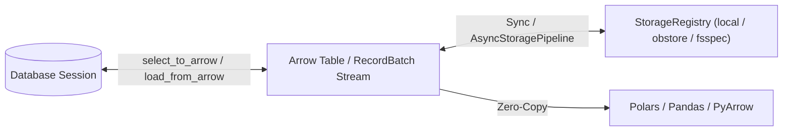

# Arrow and Storage

SQLSpec bridges relational and analytical workloads with first-class **Apache Arrow** query results (`select_to_arrow`), bulk ingestion from Arrow tables, object storage, and Python records (`load_from_arrow`, `load_from_storage`, `load_from_records`), streaming `RecordBatch` pipelines (`read_arrow_batches` / `write_arrow_batches`), pluggable object storage (`StorageRegistry` over local paths, `obstore`, and `fsspec`), and schema-aware JSONL table fixtures.



## Querying Directly to Apache Arrow, Polars, and Pandas

Call `session.select_to_arrow(...)` (or `session.fetch_to_arrow(...)`; `await` on async drivers) to return an `ArrowResult` wrapping a `pyarrow.Table` or streaming `RecordBatchReader`:

```python
from sqlspec import SQLSpec
from sqlspec.adapters.sqlite import SqliteConfig

spec = SQLSpec()
config = spec.add_config(
    SqliteConfig(connection_config={"database": ":memory:"})
)

with spec.provide_session(config) as session:
    session.execute("CREATE TABLE metrics (host TEXT, cpu_pct REAL)")
    session.execute_many(
        "INSERT INTO metrics VALUES (?, ?)", [("web-1", 41.5), ("web-2", 68.0)]
    )

    arrow_result = session.select_to_arrow(
        "SELECT host, cpu_pct FROM metrics ORDER BY host"
    )
    arrow_table = arrow_result.data
```

Adapters with native Arrow support include DuckDB, ADBC, Arrow ODBC, BigQuery's Storage Read API, and Oracle's DataFrame APIs. These paths avoid intermediate Python row dictionaries. Other DB-API adapters convert rows when `native_only=False` (the default).

Convert an `ArrowResult` to DataFrame libraries in one call:

- `arrow_result.data`: Underlying `pyarrow.Table` (when `return_format="table"`) or `RecordBatchReader` (`return_format="reader"`).
- `arrow_result.to_polars()`: Converts to a `polars.DataFrame` (requires the `polars` extra).
- `arrow_result.to_pandas()`: Converts to a `pandas.DataFrame` (requires the `pandas` extra).

### Empty Results and Explicit Schemas

Row-based drivers keep column names when a query has no rows. Without adapter type hints, each empty column has the Arrow `null` type. Set `arrow_schema=` to choose each column's type. This example requires PyArrow:

```python
--8<-- "docs/examples/querying/empty_arrow_schema.py:example"
```

The result has zero rows and the schema `host: string, cpu_pct: double`. Empty `table`, `batch`, and `reader` results retain this schema. Empty `batches` results are an empty list, so they cannot carry a schema.

## Bulk Loading from Arrow, Storage, and Python Records

Every sync and async driver exposes three symmetric bulk-ingestion entry points that route through the adapter's fastest native bulk path (`PGCOPY` on PostgreSQL, `BulkCopy` on SQL Server, Arrow C-stream registration on DuckDB/ADBC, `DBMS_CLOUD` on Oracle, and staged upserts across dialects) and return a `StorageBridgeJob`:

- `session.load_from_arrow(table, arrow_data, ...)`: Ingests a `pyarrow.Table`, `RecordBatch`, or `RecordBatchReader` into `table`.
- `session.load_from_storage(table, source, ...)`: Streams Parquet, Arrow IPC, CSV, or JSONL shards (including glob patterns like `"s3://bucket/events/*.parquet"`) into `table`.
- `session.load_from_records(table, records, ...)`: Normalizes a sequence of Python dictionaries or tuples into an Arrow table (inferring or applying `arrow_schema` / target table metadata) and delegates to `load_from_arrow`:

```python
import pyarrow as pa
from sqlspec import SQLSpec
from sqlspec.adapters.sqlite import SqliteConfig

spec = SQLSpec()
config = spec.add_config(
    SqliteConfig(connection_config={"database": ":memory:"})
)

with spec.provide_session(config) as session:
    session.execute(
        "CREATE TABLE metrics (host TEXT PRIMARY KEY, cpu_pct REAL)"
    )
    job = session.load_from_records(
        "metrics",
        [{"host": "web-1", "cpu_pct": 41.5}, {"host": "web-2", "cpu_pct": 68.0}],
        conflict_keys=["host"],
    )
    arrow_batch = pa.table({"host": ["web-1"], "cpu_pct": [52.0]})
    upsert_job = session.load_from_arrow(
        "metrics", arrow_batch, conflict_keys=["host"]
    )
```

## Unified Object Storage and StorageRegistry

`storage_registry` resolves local paths and cloud URIs (`s3://`, `gs://`, `az://`, `file://`) behind a consistent `ObjectStoreProtocol` backed by `local`, `obstore` (`obstore` extra), or `fsspec` (`fsspec` extra). In `SyncStoragePipeline` and `AsyncStoragePipeline`, use `write_rows(..., format_hint="jsonl")` for row dictionaries (`"json"` or `"jsonl"`), `write_arrow(..., format_hint="parquet")` for columnar Arrow tables (`"parquet"`, `"arrow-ipc"`, or `"csv"`), and unpack `table, telemetry = pipeline.read_arrow(...)`:

```python
from pathlib import Path
import tempfile
import pyarrow as pa

from sqlspec.storage import SyncStoragePipeline, storage_registry

with tempfile.TemporaryDirectory() as tmp_dir:
    archive_dir = Path(tmp_dir)
    storage_registry.register_alias(
        "exports", archive_dir.as_uri(), backend="local"
    )

    pipeline = SyncStoragePipeline(registry=storage_registry)
    rows = [
        {"host": "web-1", "cpu_pct": 41.5},
        {"host": "web-2", "cpu_pct": 68.0},
    ]
    pipeline.write_rows(
        rows, "alias://exports/metrics.jsonl", format_hint="jsonl"
    )
    arrow_table = pa.Table.from_pylist(rows)
    pipeline.write_arrow(
        arrow_table,
        "alias://exports/metrics.parquet",
        format_hint="parquet",
    )
    table, telemetry = pipeline.read_arrow(
        "alias://exports/metrics.parquet", file_format="parquet"
    )
```

You can also write an `ArrowResult` directly to any storage destination via `arrow_result.write_to_storage_sync("alias://exports/metrics.parquet", write_options={"row_group_size": 10_000}, overwrite=True)` (or `await arrow_result.write_to_storage_async(...)`). `file://` URIs and bare local paths resolve to `LocalStore` (`backend="local"`) by default unless `backend="obstore"` or `backend="fsspec"` is explicitly requested. Across all storage backends (`LocalStore`, `ObStoreBackend`, and `FSSpecBackend`), `write_bytes_sync`, `write_text_sync`, `write_bytes_async`, and `write_text_async` accept `overwrite=False` for atomic create-only writes, raising `FileExistsInStorageError` if the target object already exists.

### Streaming RecordBatch Coercion and Schema Validation

For datasets larger than available RAM, `SyncStoragePipeline` and `AsyncStoragePipeline` expose `read_arrow_batches(...)`, `write_arrow_batches(...)`, and `write_arrow_batches_async(...)`, and `sqlspec.utils.arrow_helpers` provides `coerce_arrow_batches(...)`:

- **Bounded-Memory Streaming**: `read_arrow_batches` yields `pyarrow.RecordBatch` chunks lazily from Parquet, Arrow IPC, or JSONL sources without materializing a full `pyarrow.Table`.
- **Single-Pass Target Schema Coercion**: When `target_schema` (or target table `ColumnMetadata`) is supplied to `load_from_arrow` or `load_from_storage`, SQLSpec validates and coerces incoming batches (`DECIMAL`, `TIMESTAMP`, `UUID`, binary, and `FIXED_SIZE_LIST` vector columns) one `RecordBatch` at a time before streaming to the database driver.

### Streaming Arrow Exports and Conditional Overwrite

`write_arrow`, `write_arrow_batches`, `write_arrow_batches_async`, and `ArrowResult.write_to_storage_sync` / `write_to_storage_async` stream `"parquet"`, `"arrow-ipc"`, and `"csv"` payloads directly to backends that satisfy `supports_direct_stream_write(backend)` and `backend.supports_direct_arrow_write(file_format, overwrite=overwrite)` (`LocalStore`, `ObStoreBackend`, and `FSSpecBackend`). Note that `"csv"` exports accept flat scalar columns only and cannot serialize list, struct, map, or vector columns.

```python
import asyncio
from pathlib import Path
import tempfile
import pyarrow as pa

from sqlspec import SQLSpec
from sqlspec.adapters.sqlite import SqliteConfig
from sqlspec.exceptions import FileExistsInStorageError
from sqlspec.storage import AsyncStoragePipeline, SyncStoragePipeline, storage_registry

spec = SQLSpec()
config = spec.add_config(SqliteConfig(connection_config={"database": ":memory:"}))

with tempfile.TemporaryDirectory() as tmp_dir, spec.provide_session(config) as session:
    export_dir = Path(tmp_dir)
    storage_registry.register_alias("stream_exports", export_dir.as_uri(), backend="local")

    session.execute("CREATE TABLE events (id INTEGER PRIMARY KEY, host TEXT, latency_ms REAL)")
    session.execute_many(
        "INSERT INTO events (id, host, latency_ms) VALUES (?, ?, ?)",
        [(1, "web-1", 12.4), (2, "web-2", 18.9), (3, "web-3", 9.1)],
    )

    arrow_result = session.select_to_arrow("SELECT host, latency_ms FROM events ORDER BY id")
    arrow_result.write_to_storage_sync(
        "alias://stream_exports/from_result.parquet",
        format_hint="parquet",
        compression="zstd",
        write_options={"row_group_size": 2},
        overwrite=True,
    )

    sync_pipeline = SyncStoragePipeline(registry=storage_registry)
    batches = pa.table({"host": ["web-1", "web-2"], "cpu_pct": [41.5, 68.0]}).to_batches(max_chunksize=1)
    sync_pipeline.write_arrow_batches(
        "alias://stream_exports/batches.parquet",
        batches,
        file_format="parquet",
        compression="zstd",
        write_options={"row_group_size": 1},
        overwrite=False,
    )

    try:
        sync_pipeline.write_arrow(
            pa.table({"host": ["web-3"], "cpu_pct": [50.0]}),
            "alias://stream_exports/batches.parquet",
            format_hint="parquet",
            write_options={"row_group_size": 1},
            overwrite=False,
        )
    except FileExistsInStorageError:
        pass

    async def write_async() -> None:
        async_pipeline = AsyncStoragePipeline(registry=storage_registry)
        async_batches = pa.table({"host": ["web-1"], "cpu_pct": [41.5]}).to_batches()
        await async_pipeline.write_arrow_batches_async(
            "alias://stream_exports/async_batches.parquet",
            async_batches,
            file_format="parquet",
            compression="zstd",
            write_options={"row_group_size": 1},
            overwrite=True,
        )

    asyncio.run(write_async())
```

During direct multipart and file streaming, peak in-flight memory stays bounded to roughly four staging chunks plus the largest single Arrow write. If an upstream batch iterator raises an exception or an async task receives `asyncio.CancelledError`, SQLSpec poisons the active writer stream so PyArrow cannot flush a trailing Parquet footer and aborts the incomplete upload or staged file without modifying any pre-existing destination object.

When `overwrite=False`, each built-in backend enforces atomic create-only semantics and raises `FileExistsInStorageError` when the target already exists:

- **`LocalStore`**: Streams into a sibling temporary file and publishes via an exclusive hard link (`os.link`).
- **`ObStoreBackend`**: Streams into a hidden `.sqlspec-stage-*` object and publishes with an atomic conditional copy (`copy_if_not_exists`). S3 stores require `copy_if_not_exists` to be configured in `storage_options` (such as `"header:If-None-Match:*"` on S3-compatible stores that support conditional copy); when `copy_if_not_exists` is unavailable on S3, `ObStoreBackend` falls back to a single-request `mode="create"` `put`. If a process terminates abruptly mid-upload, hidden `.sqlspec-stage-*` objects can remain in the bucket and can be expired automatically with a bucket lifecycle rule on the `.sqlspec-stage-` prefix.
- **`FSSpecBackend`**: Streams create-only writes on S3, GCS, Azure, and local filesystems, and uses a single exclusive write (`open(..., "xb")`) on other filesystems.

### Streaming Database Exports and Type Settlement

`session.select_to_storage(...)` streams query results in batches across every adapter with a client-side export path, including Db2 and `mssql-python`. Pass `return_format="table"` when you explicitly want `select_to_storage` to materialize a full `pyarrow.Table` before writing.

On row-streaming adapters, SQLSpec inspects the first batch to pin the Arrow schema:

- **Settled in One Batch**: Flat scalar columns (strings, floats, booleans, dates, timestamps, binary values) and floating-point vector lists settle on the first batch and stream directly with bounded memory.
- **Full-Result Read-Ahead for Unsettled Types**: Encountering a `NULL`, `Decimal`, struct, or map value at any nesting depth, or an integer inside a list, causes SQLSpec to read the full result into columnar memory first so the column's Arrow type is settled accurately. SQLite integer columns and Oracle row-stream integer columns also trigger read-ahead because later rows can hold floating-point values.
- **Avoiding Read-Ahead**: Drivers that report exact decimal precision and scale (`PyMySQL`, `aiomysql`, `asyncmy`, and `psycopg`) settle decimal columns on the first batch, and safe declared column types settle all-`NULL` columns without read-ahead. Passing an explicit `arrow_schema=...` always avoids read-ahead for every column.
- **Columns Unbounded by Default**: Without `arrow_schema`, struct and JSON columns, integer array columns, all-`NULL` columns with no safe declared type, decimals without driver precision (including every decimal on `mysql-connector`, `asyncpg`, `psqlpy`, and `pymssql`), and SQLite and Oracle row-stream integer columns remain read-ahead columns.
- **Observability and Mid-Stream Type Changes**: Whenever read-ahead runs, SQLSpec logs `storage.export.read_ahead` and records the column names in `job.telemetry["extra"]["read_ahead_columns"]`. If a pinned column changes type family in a later batch, PyArrow raises an Arrow type error, the in-flight stream aborts, and nothing is published at the destination.

### Custom Multipart Backends

Custom storage backends opt into zero-buffering Arrow exports by implementing `DirectStreamWriteProtocol` (`supports_direct_arrow_write`, `open_write_stream_sync`, and `open_write_stream_async`). Verify protocol conformance at runtime with `supports_direct_stream_write` and stream Arrow payloads with `encode_arrow_to_sink` or `encode_arrow_to_async_sink`:

```python
from collections.abc import AsyncIterator, Iterator
from contextlib import asynccontextmanager, contextmanager
from pathlib import Path
from typing import Any
import pyarrow as pa

from sqlspec.protocols import AsyncWritableBytesSink, WritableBytesSink
from sqlspec.storage import StorageFormat, encode_arrow_to_sink
from sqlspec.utils.type_guards import supports_direct_stream_write


class InMemoryMultipartStore:
    """Minimal custom store demonstrating DirectStreamWriteProtocol."""

    def __init__(self) -> None:
        self.objects: dict[str, bytes] = {}

    def supports_direct_arrow_write(
        self, file_format: StorageFormat, *, overwrite: bool = True
    ) -> bool:
        return overwrite and file_format in {"parquet", "arrow-ipc", "csv"}

    @contextmanager
    def open_write_stream_sync(
        self, path: str | Path, *, overwrite: bool = True, **kwargs: Any
    ) -> Iterator[WritableBytesSink]:
        _ = (overwrite, kwargs)
        parts: list[bytes] = []

        class _PartSink:
            def write(self, data: bytes, /) -> int:
                parts.append(bytes(data))
                return len(data)

        yield _PartSink()
        self.objects[str(path)] = b"".join(parts)

    @asynccontextmanager
    async def open_write_stream_async(
        self, path: str | Path, *, overwrite: bool = True, **kwargs: Any
    ) -> AsyncIterator[AsyncWritableBytesSink]:
        _ = (overwrite, kwargs)
        parts: list[bytes] = []

        class _AsyncPartSink:
            async def write(self, data: bytes, /) -> int:
                parts.append(bytes(data))
                return len(data)

        yield _AsyncPartSink()
        self.objects[str(path)] = b"".join(parts)


store = InMemoryMultipartStore()
assert supports_direct_stream_write(store)
with store.open_write_stream_sync("metrics.parquet") as sink:
    bytes_written, rows_written = encode_arrow_to_sink(
        pa.table({"host": ["web-1"], "cpu_pct": [41.5]}),
        sink,
        format_hint="parquet",
    )
```

## Schema-Aware Table Fixtures

`sqlspec.utils.fixtures` exports and loads per-table `.json`, `.json.gz`, `.jsonl`, and `.jsonl.gz` files while introspecting live column types (`UUID`, ISO timestamps, `Decimal`, base64 `bytes`, `JSON`/`JSONB`, identity columns, and sequence resyncing) via `driver.data_dictionary`:

```python
from pathlib import Path
import tempfile

from sqlspec import SQLSpec
from sqlspec.adapters.sqlite import SqliteConfig
from sqlspec.utils.fixtures import (
    export_table_fixtures_sync,
    load_table_fixtures_sync,
)

spec = SQLSpec()
config = spec.add_config(
    SqliteConfig(connection_config={"database": ":memory:"})
)

with (
    tempfile.TemporaryDirectory() as tmp_dir,
    spec.provide_session(config) as session,
):
    fixtures_dir = Path(tmp_dir)
    session.execute(
        "CREATE TABLE roles (id INTEGER PRIMARY KEY, slug TEXT UNIQUE)"
    )
    session.execute("INSERT INTO roles (slug) VALUES ('admin'), ('reader')")

    export_table_fixtures_sync(
        session, fixtures_dir, ["roles"], jsonl=True, compress=False
    )
    counts = load_table_fixtures_sync(
        session,
        fixtures_dir,
        tables=["roles"],
        conflict_keys={"roles": "slug"},
        exclude_update_columns={"roles": ["id"]},
    )
```

## Recap

- Use `select_to_arrow`, `select_to_storage`, and `load_from_arrow` / `load_from_records` / `load_from_storage` for columnar queries, streaming storage exports, and native bulk loads.
- Use `pipeline.write_rows(..., format_hint="jsonl")` for JSON/JSONL row payloads, `pipeline.write_arrow(...)` and `pipeline.write_arrow_batches(...)` (with `write_options=...` and `overwrite=False` when create-only protection is needed) for streaming Parquet/Arrow IPC/CSV exports, and unpack `table, telemetry = pipeline.read_arrow(...)`.
- Register named storage buckets on `storage_registry` (`s3://`, `gs://`, `az://`, or `backend="local"`) or implement `DirectStreamWriteProtocol` on custom backends so application code addresses portable `alias://...` destinations.
