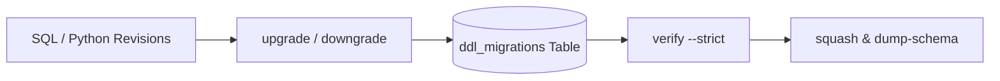

# Migrations

SQLSpec includes a built-in schema migration runner supporting sequential `.sql` and `.py` revisions across every sync and async adapter—without requiring SQLAlchemy or Alembic when your project is pure SQL.



## Configure Migration Settings and pyproject.toml

Enable migrations on any adapter configuration by supplying `migration_config`:

```{ .python title="docs/examples/migration_quickstart_config.py" }
--8<-- "docs/examples/migration_quickstart_config.py:example"
```

Point `[tool.sqlspec]` in `pyproject.toml` at your module attribute or factory callable so the `sqlspec` CLI discovers configurations automatically:

```toml
[tool.sqlspec]
config = "app.db:database_config"
```

Common `MigrationConfig` keys:

- `script_location`: Directory containing migration files (`"migrations"` by default).
- `version_table_name`: Tracking table name (`"ddl_migrations"` by default).
- `default_schema`: Default target schema for unqualified DDL objects.
- `version_table_schema`: Dedicated admin schema holding the version-tracking table.
- `include_extensions`: Optional list of extension schemas to bundle (such as `["litestar", "adk", "events"]`).
- `schema_dump_path`: Default output path written by `dump_schema()` when `output_path` is omitted (`auto_dump_schema=True` falls back to `<script_location>/schema.sql` when `schema_dump_path` is unset).
- `auto_dump_schema`: Set to `True` (or a file path) to refresh `schema.sql` automatically after every `upgrade` that applies revisions.

`default_schema`, `version_table_schema`, and `-- schema:` directives require an adapter with migration schema support: PostgreSQL drivers, CockroachDB, DuckDB, Oracle, IBM Db2, SQL Server, Snowflake, and PostgreSQL-backed ADBC. Other adapters raise `MigrationError`. To keep the tracking table in a specific schema on those adapters, set `version_table_name` to `"<schema>.ddl_migrations"`.

SQLSpec restores the session schema after each migration, whether it succeeds or fails. A failed transactional migration rolls back first, and the original error is reported.

## Authoring SQL and Python Revisions

Revisions execute in lexical prefix order (`0001_...`, `0002_...` or timestamp prefixes normalized via `sqlspec fix`). You can mix `.sql` and `.py` files in the same `migrations/` directory:

=== "SQL Revision (`0001_create_users.sql`)"

    ```sql
    -- name: migrate-0001-up
    CREATE TABLE users (
        id INTEGER PRIMARY KEY,
        email TEXT NOT NULL UNIQUE,
        created_at TIMESTAMP DEFAULT CURRENT_TIMESTAMP
    );

    -- name: migrate-0001-down
    DROP TABLE IF EXISTS users;
    ```

=== "Python Revision (`0001_create_users.py`)"

    ```python
    def up() -> list[str]:
        return [
            """
            CREATE TABLE users (
                id INTEGER PRIMARY KEY,
                email TEXT NOT NULL UNIQUE
            )
            """
        ]


    def down() -> list[str]:
        return ["DROP TABLE IF EXISTS users"]
    ```

## Multi-Schema Migration Tracking

Enterprise deployments frequently store application tables in `app_schema` while isolating migration tracking metadata in `admin_schema`. Configure `default_schema` and `version_table_schema` together—or invoke `SyncMigrationCommands` / `AsyncMigrationCommands` programmatically:

```{ .python title="docs/examples/patterns/migrations_with_schema.py" }
--8<-- "docs/examples/patterns/migrations_with_schema.py:example"
```

When PostgreSQL adapters (`AsyncpgConfig`, `PsycopgSyncConfig`, `PsycopgAsyncConfig`, `PsqlpyConfig`) run behind transaction-mode PgBouncer (`pooler_mode="transaction"`) and define `direct_dsn`, `MigrationCommands` automatically routes DDL execution through `config.derive_direct_config()` so session-level locks and DDL statements bypass the transaction pooler.

## Lifecycle, Squash, and Schema Commands

| Action | CLI Command | Behavior |
| --- | --- | --- |
| Apply pending revisions | `uv run sqlspec upgrade` | Runs unapplied migrations in lexical order and records each version in `version_table_name`. |
| Target a specific revision | `uv run sqlspec upgrade 0003` | Applies pending revisions up to and including `0003`. |
| Roll back revisions | `uv run sqlspec downgrade -1` | Executes the `down` section of the most recently applied revision (`downgrade base` reverts all). |
| Verify checksums & drift | `uv run sqlspec verify --strict` | Read-only audit of applied checksums, orphaned tracker rows, pending files, and partial squashes. |
| Export live schema DDL | `uv run sqlspec dump-schema -o migrations/schema.sql` | Writes topologically ordered schema DDL to `--output` or directly to stdout. |
| Bootstrap from live schema | `uv run sqlspec create-migration -m "baseline" --from-schema` | Populates a new `.sql` or `.py` revision with `CREATE` DDL in `up` and reverse `DROP` DDL in `down`. |
| Bootstrap from data | `uv run sqlspec create-migration -m "events" --from-data events.jsonl` | Infers a typed `CREATE TABLE` revision from a JSON/JSONL/Parquet/Arrow file or staging table. |
| Baseline an existing DB | `uv run sqlspec stamp head` | Records the target revision in `version_table_name` without executing DDL statements. |
| Consolidate history | `uv run sqlspec squash 1:10 -m "baseline" --strategy ddl --yes` | Collapses a revision range (or all revisions when omitted) into one file with `-- Squashed from:` metadata. |

## Squashing Strategies and Reconciliation

`sqlspec squash` (and `commands.squash(...)`) consolidates sequential or timestamp revisions into one baseline file while recording superseded versions in `-- Squashed from:` (SQL) or `__replaces__` / `Squashed from:` (Python) file headers:

```{ .python title="docs/examples/patterns/migration_squash_and_schema.py" }
--8<-- "docs/examples/patterns/migration_squash_and_schema.py:example"
```

Choose the squash strategy that matches your migration history:

- `concat` (**default**): Preserves every `up` statement verbatim in chronological order and reverses `down` statements. Safe for histories containing seed `INSERT`/`UPDATE` DML, views, triggers, functions, or procedural blocks.
- `ddl`: Parses chronological DDL with SQLGlot and folds `CREATE` / `ALTER` / `DROP` / `RENAME` operations into net `CREATE TABLE`, `CREATE SEQUENCE`, and `CREATE INDEX` statements. Fails closed with `SquashValidationError` whenever a statement (such as data DML, views/triggers, dynamic PL/SQL, or destructive column rewrites) cannot be folded faithfully.
- `schema`: Emits topological DDL reflected directly from the live database catalog via `driver.data_dictionary.get_schema_ddl(...)`.

When `upgrade()` runs against downstream environments after a squash has been committed:

1. **All replaced versions applied**: SQLSpec replaces the superseded tracker rows with the squashed revision (`replaces` metadata recorded) without re-executing DDL. Under `--dry-run`, reconciliation is reported without mutating `version_table_name`.
2. **No replaced versions applied**: Fresh databases execute the squashed migration once.
3. **Partial overlap**: If only a subset of replaced versions was applied, `upgrade()` and `verify --strict` raise an error rather than guessing which statements remain unapplied.

## Unversioned Extension Schema Reconciliation

Built-in extensions (`adk`, `litestar`, and `events`) and external packages default to idempotent unversioned schema reconciliation (`migration_mode="reconcile"`) instead of recording synthetic `ext_<name>_*` rows in `ddl_migrations` (automatically falling back to `"versioned"` when an unconfigured external extension directory provides only numbered `0001_*` revisions and no `reconcile.py`):

```{ .python title="docs/examples/quickstart_migrations.py" }
--8<-- "docs/examples/quickstart_migrations.py:reconcile"
```

### Configuring Built-In and External Extensions

`"reconcile"` (`from sqlspec.config import ExtensionMigrationMode`) is the default mode for extensions:

- **Built-in extensions**: `adk`, `litestar` (when `session_table` is enabled), and `events` reconcile automatically; pass `"migration_mode": "versioned"` inside `extension_config[name]` only if you need numbered `ext_<name>_*` revision rows.
- **External extensions**: Call `config.add_extension_migrations(name, migrations_path, settings=None, *, migration_mode="reconcile")` (which mutates `config` in place and returns `None`), or pass `settings={"migration_mode": "versioned"}` when targeting numbered files.

### Authoring an Extension Reconciler Callback

Place a `reconcile.py` module inside `<migrations_path>` exporting a synchronous or asynchronous `reconcile(context: MigrationContext) -> None` and an optional `downgrade(context: MigrationContext) -> None` (or `down`) callback (`from sqlspec.migrations.context import MigrationContext`). Run DDL on `context.driver` within the migration runner's transaction and schema lifecycle, and pass `manage_schema=True, commit=False, strict=True` to `ensure_schema_sync` or `ensure_schema_async` (`manage_schema` defaults to `False`, `commit=False` leaves transaction commit and rollback to the runner, and `strict=True` refuses lossy or ambiguous schema changes).

### Scheduling, Base-Only Downgrade, and Ledger Retention

- **Upgrade execution order**: Reconcilers execute in `include_extensions` order before pending numbered revisions on every `upgrade(revision)` (both `upgrade("head")` and targeted revisions), including when zero numbered migrations are pending. Co-located numbered migration files for that extension are skipped, and zero `ext_<name>_*` rows are inserted into `ddl_migrations`.
- **Drop-at-base downgrade**: Partial downgrades (such as rolling back `0002 -> 0001`) preserve reconciled extension tables. When `downgrade` reaches `base` (`downgrade("base")` or `downgrade("-1")` leaving zero applied revisions in `ddl_migrations`), SQLSpec executes each reconciler's `downgrade(context)` callback in reverse `include_extensions` order to drop the extension schema and removes any retained `ext_<name>_*` ledger rows. `downgrade --dry-run` at base previews reconciler downgrades without executing DDL.
- **Retained ledger & versioned extension ordering**: Any previously applied `ext_<name>_*` rows already present in `ddl_migrations` pass `sqlspec verify --strict` without orphan warnings. When an extension uses `migration_mode="versioned"`, its `ext_<name>_*` migrations sort before core migrations in `include_extensions` order and are excluded from out-of-order and auto-sync checksum warnings.
- **Serialized upgrades**: SQLSpec adds no distributed migration lock, so run `upgrade` from one process at a time (such as a release job rather than every replica at startup). If concurrent upgrades race and one fails with a duplicate-object error, re-running `upgrade` converges idempotently.

### Strict Schema Safety and Built-In Adapter Coverage

When `strict=True`, `ensure_schema_sync` and `ensure_schema_async` raise `MigrationError` before executing DDL if a target requires missing `constraint_columns` (`PRIMARY KEY`, `UNIQUE`, `FOREIGN KEY`, or `CHECK`), `unsafe_add_columns` (generated, identity, or collated columns), defaultless `NOT NULL` columns, missing tables when `create_schema=False`, or existing-column nullability narrowing or cross-family type drift. Existing-row backfills and versioned data conversions remain separate work.

Built-in reconcilers (`litestar`, `events`, and `adk`) run across:

- **22 unconditional adapters**: `sqlite`, `aiosqlite`, `asyncpg`, `psycopg`, `psqlpy`, `cockroach_asyncpg`, `cockroach_psycopg`, `aiomysql`, `asyncmy`, `pymysql`, `mysqlconnector`, `duckdb`, `mssql_python`, `pymssql`, `oracledb`, `spanner`, `snowflake`, `bigquery`, `db2`, `sqlanywhere`, `sybase`, and `teradata`.
- **Arrow ODBC (`arrow_odbc`)**: Supported when `statement_config.dialect` is `"mssql"`, `"tsql"`, or `"db2"`.
- **Apache Arrow ADBC (`adbc`)**: Supported on every backend with a resolved dialect (`postgresql`, `sqlite`, `duckdb`, `bigquery`, `snowflake`, `mssql`, `oracle`, `db2`, `teradata`, and `mysql`).

Remaining built-in refusals and their remedies:

- **ADBC over FlightSQL without a dialect**: Configure an explicit `statement_config` dialect or `gizmosql_backend` (`"duckdb"` or `"sqlite"`), or set `migration_mode="versioned"`.
- **Arrow ODBC outside SQL Server or Db2, or unresolvable/external adapters**: Register a custom `reconcile.py` via `add_extension_migrations(..., migration_mode="reconcile")` (custom callbacks control their own dialect checks) or keep `migration_mode="versioned"`.
- **Constrained or unsafe column additions, or BigQuery `NOT NULL`/defaulted columns on existing tables**: Author an explicit numbered `.sql` or `.py` revision for non-additive or backfilled schema transitions.

## Schema Snapshots, Verification, and Data Bootstrap

- **Read-Only `verify`**: Checks applied tracker rows against migration files on disk without creating `version_table_name` on empty databases. Combine `--strict` with `--fail-on-pending` as a pre-deploy CI gate.
- **Deterministic `dump-schema`**: Exports live schema DDL excluding `version_table_name` by default (`--include-migrations-table` includes it; `--target-dialect` transpiles across SQLGlot dialects). Omitting `--output` writes pure SQL to stdout so `sqlspec dump-schema > schema.sql` produces a clean SQL script.

### How Data Bootstrap Classifies Sources

`create-migration --from-data <source>` classifies `<source>` deterministically from its spelling rather than checking local filesystem state first:

- Values containing a path separator (`seeds/users.json`) or ending in a data suffix (`.json`, `.json.gz`, `.jsonl`, `.jsonl.gz`, `.ndjson`, `.ndjson.gz`, `.parquet`, `.arrow`, `.ipc`, `.feather`) are treated as **files**. Missing files, directories, or unsupported suffixes (such as `.csv`) fail immediately without writing a migration file.
- All other values are treated as **table names** (`raw_staging_users` or `staging.raw_users`) and profiled via `driver.data_dictionary.infer_table_ddl_from_data(...)`. Pass `--schema public --from-data json` when profiling a table whose name matches a file suffix.

## Recap

- Declare `migration_config` on your adapter config and `config = "module:attr"` under `[tool.sqlspec]` in `pyproject.toml`.
- Keep `--strategy concat` when squashing histories that mix DDL and data migrations, and use `--strategy ddl` or `--strategy schema` to produce compact `CREATE`-only baselines.
- Pair `sqlspec verify --strict --fail-on-pending` and `auto_dump_schema: True` to catch drift early and keep `schema.sql` reviewable in pull requests.
