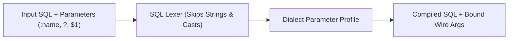

# Parameters

Python database drivers disagree on parameter placeholder syntax: PostgreSQL `asyncpg` and `psqlpy` expect `$1, $2`, `psycopg` and MySQL drivers expect `%s`, SQLite and ODBC drivers expect `?`, Oracle expects `:1` or `:name`, and Spanner GoogleSQL expects `@name`. SQLSpec's parameter compiler lets you write readable parameters once and translates them to each adapter's wire format automatically.

## Named and Positional Binding

Pass named parameters either as keyword arguments (`status="active"`) or as a dictionary (`{"status": "active"}`), and positional parameters as positional arguments or a tuple/list:

```{ .python title="docs/examples/drivers/parameter_binding.py" }
--8<-- "docs/examples/drivers/parameter_binding.py:example"
```

When the same named parameter (`:status`) appears multiple times in a query, SQLSpec binds the value once by name and expands positional placeholders (`$1`, `?`, `%s`) in occurrence order automatically for drivers that only support positional wire binding.

### Reusable `SQL` Statement Objects

In addition to passing SQL strings directly to `session.select(...)`, you can construct an explicit `SQL` statement object with pre-bound positional or named parameters and execute or inspect it across sessions:

```python
from sqlspec import SQL, SQLSpec
from sqlspec.adapters.sqlite import SqliteConfig

spec = SQLSpec()
config = spec.add_config(
    SqliteConfig(connection_config={"database": ":memory:"})
)

with spec.provide_session(config) as session:
    session.execute(
        "CREATE TABLE users (id INTEGER PRIMARY KEY, email TEXT, role TEXT)"
    )
    session.execute(
        "INSERT INTO users (email, role) VALUES (:email, :role)",
        email="ada@example.com",
        role="admin",
    )

    lookup = SQL("SELECT id, email FROM users WHERE role = :role", role="admin")
    admins = session.select(lookup)
    assert admins == [{"id": 1, "email": "ada@example.com"}]
```

### Batched Parameter Sequences (`execute_many`)

`execute_many` accepts either a sequence of positional tuples or a sequence of named parameter dictionaries, compiling the parameter layout once for the entire batch:

```python
session.execute_many(
    "INSERT INTO users (email, role) VALUES (:email, :role)",
    [
        {"email": "grace@example.com", "role": "maintainer"},
        {"email": "linus@example.com", "role": "reviewer"},
    ],
)
```

## Cross-Dialect Placeholder Translation



| Input Style Written in SQL | Example | Compiled Output (`asyncpg`) | Compiled Output (`sqlite` / `duckdb`) | Compiled Output (`spanner`) |
| --- | --- | --- | --- | --- |
| Named colon (`:name`) | `WHERE status = :status` | `WHERE status = $1` | `WHERE status = ?` | `WHERE status = @status` |
| Positional qmark (`?`) | `WHERE id = ?` | `WHERE id = $1` | `WHERE id = ?` | `WHERE id = @p1` |
| Positional numeric (`$1`) | `WHERE id = $1` | `WHERE id = $1` | `WHERE id = ?` | `WHERE id = @p1` |

String literals (`'active:1'`), SQL comments, PostgreSQL type casts (`value::text`), and JSONB operators are preserved by the lexer without false-positive placeholder rewriting.

## Keep Parameter Styles Consistent When Using Filters

Composable `StatementFilter` objects—such as `LimitOffsetFilter`, `BeforeAfterFilter`, `SearchFilter`, and `InCollectionFilter`—append **named** parameters (like `:limit` and `:offset`) to the compiled statement.

Do not mix positional query parameters (`?` with a tuple/list) and `StatementFilter` instances on the same call. When a statement contains both positional and named parameters, named parameter resolution takes precedence and positional values cannot be matched cleanly. Always bind primary query arguments as named parameters when attaching filters:

```python
from sqlspec import SQLSpec
from sqlspec.adapters.sqlite import SqliteConfig
from sqlspec.core import LimitOffsetFilter

spec = SQLSpec()
config = spec.add_config(
    SqliteConfig(connection_config={"database": ":memory:"})
)

with spec.provide_session(config) as session:
    session.execute(
        "CREATE TABLE tasks (id INTEGER PRIMARY KEY, owner_id INTEGER, title TEXT)"
    )
    session.execute(
        "INSERT INTO tasks (owner_id, title) VALUES (:owner_id, :title)",
        owner_id=7,
        title="Write docs",
    )

    page_filter = LimitOffsetFilter(limit=20, offset=0)
    rows = session.select(
        "SELECT id, title FROM tasks WHERE owner_id = :owner_id ORDER BY id",
        page_filter,
        owner_id=7,
    )
```

## Dialect Type Inference Tips

Certain binary-protocol drivers require explicit SQL casts when a parameter appears inside a polymorphic function call:

- **PostgreSQL `asyncpg` inside `jsonb_build_object`**: Wrap untyped string parameters as `CAST(:name AS text)` so PostgreSQL can infer the parameter OID during statement preparation.
- **PostgreSQL JSONB `?` existence operator**: On drivers or builders where `?` is configured as a positional placeholder, prefer `jsonb_exists(payload, :key)` or named `:key` styles so operator tokens stay unambiguous.
- **Collection membership (`WHERE id IN ...`)**: Prefer `InCollectionFilter("id", values)` or `sql.select(...).where_in("id", values)` over manual string join templates.

## Recap

- Prefer `:named` parameters for multi-argument queries, especially whenever `StatementFilter` objects are attached.
- Use positional parameters (`?` or `$1`) for short single-argument lookups and tight `execute_many` tuple batches.
- Never interpolate untrusted values into SQL strings with f-strings; bind values as parameters and restrict dynamic identifiers to validated allowlists.
