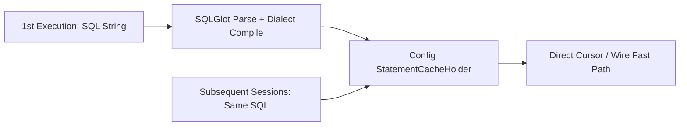

# Performance

SQLSpec is engineered so SQL-first convenience adds minimal overhead above raw C/Rust database drivers. Understanding how statement caching, compiled wheels, typed hydration, and columnar fetches interact helps you get peak throughput across OLTP and analytical workloads.

## Per-Config Statement Caching (`StatementCacheHolder`)

Every adapter config (`AsyncpgConfig`, `SqliteConfig`, `OracleAsyncConfig`, etc.) owns a thread-safe `StatementCacheHolder` shared across all sessions opened via `config.provide_session()`.

On the first execution of a SQL string, SQLSpec parses the SQLGlot AST, compiles dialect placeholders, determines operation profile metadata, and stores a `CachedQuery` entry. Subsequent executions in **any** session from that config take the direct fast path:

- Zero SQLGlot re-parsing or AST deep-copying (`ProcessedState.expression_is_shared` uses copy-on-write only if a caller mutates `.expression`).
- `SlotPooledStatement` instances reuse slotted wrapper state across executions.
- Lazy `SQLResult.statement` construction avoids allocating `SQL` wrappers on read queries unless `.statement` is explicitly inspected.
- Wire-level `enable_sqlcommenter=True` and active `ObservabilityConfig` spans/observers preserve the fast path.

Always open sessions with `config.provide_session()` or `spec.provide_session(config)` rather than instantiating `*Driver(connection=...)` directly—direct driver construction bypasses `_prepare_driver()` and allocates an unshared cache per call.



### Writing Cache-Friendly Call Shapes

Pass SQL strings with keyword arguments, a single parameter dictionary, or a positional tuple so calls match the direct cache key without creating per-call SQL string variants:

```python
from sqlspec import SQLSpec
from sqlspec.adapters.sqlite import SqliteConfig

spec = SQLSpec()
config = spec.add_config(
    SqliteConfig(connection_config={"database": ":memory:"})
)

with spec.provide_session(config) as session:
    session.execute(
        """
        CREATE TABLE accounts (
            id INTEGER PRIMARY KEY,
            region TEXT,
            balance INTEGER
        )
        """
    )
    session.execute_many(
        "INSERT INTO accounts (region, balance) VALUES (?, ?)",
        [("us-east", 500), ("eu-west", 900)],
    )

    for region in ("us-east", "eu-west"):
        rows = session.select(
            "SELECT id, balance FROM accounts WHERE region = :region",
            region=region,
        )
        assert len(rows) == 1
```

## Pre-Compiled `mypyc` Wheels and `sqlglot[c]`

SQLSpec compiles `162` hot-path modules—covering `core`, `driver`, `builder`, `dialects`, `migrations`, `data_dictionary`, `storage`, `service`, `observability`, `utils`, `extensions`, and adapter cores/pools/type converters—to native C extensions via `mypyc`.

Install the `mypyc` and `performance` extras in production deployments so SQLGlot also uses its compiled C tokenizer/parser (`sqlglot[c]`) alongside `msgspec`:

```bash
uv add "sqlspec[mypyc,performance]"
```

## Fast Typed Hydration with `msgspec.Struct`

When mapping rows into Python objects, `msgspec.Struct(..., frozen=True, gc=False)` avoids per-row Pydantic validator overhead and omits CPython's `PyGC_Head` cyclic garbage-collection tracking header:

```python
import msgspec


class OrderSummary(msgspec.Struct, frozen=True, gc=False):
    order_id: int
    customer_id: int
    total_cents: int
```

For serialization on hot HTTP or queue paths, pair `msgspec.Struct` with SQLSpec's centralized `msgspec`-backed JSON encoders (`sqlspec.utils.serializers`).

## Batched Writes and Arrow Thresholds

- **Prefer `execute_many` or `select_to_arrow` over row loops**: Single-pass parameter preparation in `execute_many` avoids repeated per-row compilation.
- **DuckDB Hybrid Materialization**: Small DuckDB point lookups (`< 64` rows) and Arrow-divergent types (`HUGEINT`, `MAP`, `INTERVAL`, `TIMETZ`) materialize directly via `fetchall()` to avoid ~110 µs Arrow conversion overhead on 1-row reads, while larger analytical scans stream natively through Arrow.
- **Large Analytical Exports**: Use `session.select_to_arrow(..., return_format="batches")` or `session.select_stream(..., chunk_size=1000)` to bound resident memory on multi-million-row reads.

## Summary Checklist

| Lever | Recommendation |
| --- | --- |
| **Session Creation** | Always use `config.provide_session()` / `spec.provide_session(config)` so `StatementCacheHolder` is shared across requests. |
| **Compiled Runtime** | Install `sqlspec[mypyc,performance]` to pair compiled `sqlspec` wheels with `sqlglot[c]` and `msgspec`. |
| **Row Models** | Use `msgspec.Struct(..., frozen=True, gc=False)` or `TypedDict` on latency-sensitive endpoints. |
| **Parameter Style** | Pass a dict/kwargs or tuple directly to `session.select(sql, ...)` so calls hit the direct statement cache path. |
| **Bulk Reads/Writes** | Use `execute_many` for multi-row DML and `select_to_arrow` for columnar exports. |
