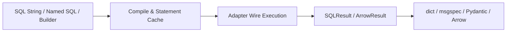

# Querying

Every SQLSpec driver exposes a uniform set of query methods on `session` (sync) and `await session` (async) so you can express row cardinality intent directly at the call site without unpacking raw DB-API cursors.



## Choosing the Right Execution Method

| Method | Return Value | Behavior on Empty Result |
| --- | --- | --- |
| `execute(sql, ...)` | `SQLResult` | Returns metadata (`rows_affected`) and row helpers (`.all()`, `.one()`, `.one_or_none()`) |
| `select(sql, ...)` | `list[dict[str, Any]]` or `list[SchemaT]` | Returns `[]` |
| `select_one(sql, ...)` | `dict[str, Any]` or `SchemaT` | Raises `NotFoundError` (and raises if multiple rows match) |
| `select_one_or_none(sql, ...)` | `dict[str, Any] \| SchemaT \| None` | Returns `None` (raises if multiple rows match) |
| `select_value(sql, ..., value_type=...)` | Scalar value (`Any` or `ValueT`) | Raises `NotFoundError` |
| `select_value_or_none(sql, ...)` | Scalar value or `None` | Returns `None` |
| `select_with_total(sql, ...)` | `tuple[list[...], int]` | Returns `([], 0)` alongside the total unpaginated count |
| `execute_many(sql, seq_of_params)` | `SQLResult` | Executes batched DML across a sequence of parameter tuples or dicts |
| `execute_script(sql)` | `SQLResult` | Runs multi-statement DDL or seed scripts |

Note that there is no `select_value_list` method on driver sessions; to extract a list of values from a single column, call `select(...)` and project the column key from each returned row.

## Inspecting `SQLResult` Metadata

While `select*` helpers return rows or scalars directly, `session.execute(...)` returns a `SQLResult` carrying affected row counts, column names, and convenience accessors for `INSERT ... RETURNING` or `UPDATE` statements:

```python
from sqlspec import SQLSpec
from sqlspec.adapters.sqlite import SqliteConfig

spec = SQLSpec()
config = spec.add_config(
    SqliteConfig(connection_config={"database": ":memory:"})
)

with spec.provide_session(config) as session:
    session.execute(
        "CREATE TABLE items (id INTEGER PRIMARY KEY, name TEXT, active INTEGER)"
    )
    insert_result = session.execute(
        "INSERT INTO items (name, active) VALUES (:name, :active)",
        name="Keyboard",
        active=1,
    )
    assert insert_result.rows_affected == 1

    returning_result = session.execute(
        """
        UPDATE items
        SET active = :active
        WHERE name = :name
        RETURNING id, name
        """,
        active=0,
        name="Keyboard",
    )
    updated_row = returning_result.one()
    assert updated_row == {"id": 1, "name": "Keyboard"}
```

Use `.one()`, `.one_or_none()`, or `.all()` on `SQLResult` when executing DML statements with `RETURNING` clauses.

## Batched Writes, Scalars, and Totals

Use `execute_many` for multi-row inserts or updates, `select_value` / `select_value_or_none` for scalar aggregates or lookups, and `select_with_total` when pairing a paginated query with a count query:

```{ .python title="docs/examples/querying/batch_operations.py" }
--8<-- "docs/examples/querying/batch_operations.py:example"
```

## Multi-Step Execution with `StatementStack`

When you want to group ordered DDL, batched DML, and `SELECT` operations into a single logical sequence—taking advantage of native driver pipelining where supported (such as PostgreSQL `asyncpg` or Oracle 23ai/26ai)—compose a `StatementStack` and pass it to `session.execute_stack(stack)`:

```{ .python title="docs/examples/querying/statement_stack.py" }
--8<-- "docs/examples/querying/statement_stack.py:example"
```

Each entry in the returned sequence wraps the step's `SQLResult` so you can inspect `rows_affected` or call `.all()` on row-returning steps.

## Bounded Cursor Streaming

Materializing millions of rows with `select()` buffers the entire result set in memory. Use `session.select_stream(..., chunk_size=...)` (`async with session.select_stream(...)` on async drivers) to iterate over rows in bounded chunks:

```{ .python title="docs/examples/querying/streaming_results.py" }
--8<-- "docs/examples/querying/streaming_results.py:example"
```

=== "Sync"

    ```python
    query = "SELECT id, payload FROM events ORDER BY id"
    with session.select_stream(query, chunk_size=500) as stream:
        for row in stream:
            process_row(row)
    ```

=== "Async"

    ```python
    query = "SELECT id, payload FROM events ORDER BY id"
    async with session.select_stream(query, chunk_size=500) as stream:
        async for row in stream:
            await process_row(row)
    ```

For columnar analytics or Parquet export over large result sets, prefer `session.select_to_arrow(...)` (covered in [Arrow and Storage](arrow-and-storage.md)).

## Recap

- Prefer `select`, `select_one`, `select_one_or_none`, and `select_value` for concise, self-documenting reads, and `execute` when you need `SQLResult.rows_affected` on `INSERT`, `UPDATE`, or `DELETE` statements.
- Use `execute_many` instead of Python loops for multi-row writes.
- Switch to `select_stream` (row-oriented) or `select_to_arrow` (columnar) whenever result sets exceed comfortable per-request memory bounds.
