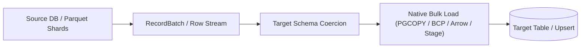

# ETL and Bulk Ingest

Moving data between operational databases, analytical engines, and cloud object storage requires bounded memory usage and batched or columnar execution. SQLSpec provides graduated execution paths depending on dataset volume: batched DB-API writes (`execute_many` + `select_stream`), zero-copy **Apache Arrow** transfers (`select_to_arrow` + `load_from_arrow`), and direct **Storage Bridge** jobs (`select_to_storage` + `load_from_storage`).



## Cross-Database Extract, Transform, and Load

Register source and target configurations on a single `SQLSpec` instance to extract filtered rows from an upstream store and batch-load transformed records into a downstream target:

```python
--8<-- "docs/examples/patterns/etl_pipeline.py:example"
```

## Bounded-Memory Chunked Streaming

When extracting hundreds of thousands of rows over DB-API drivers, pair `session.select_stream(..., chunk_size=1000)` with batched `execute_many` slices so resident memory stays flat regardless of table size:

```python
from itertools import islice

from sqlspec import SQLSpec
from sqlspec.adapters.sqlite import SqliteConfig

spec = SQLSpec()
source = spec.add_config(
    SqliteConfig(connection_config={"database": ":memory:"})
)
target = spec.add_config(
    SqliteConfig(connection_config={"database": ":memory:"})
)

with spec.provide_session(source) as src, spec.provide_session(target) as dst:
    src.execute(
        """
        CREATE TABLE raw_events (id INTEGER PRIMARY KEY, kind TEXT)
        """
    )
    src.execute_many(
        "INSERT INTO raw_events (kind) VALUES (?)",
        [("click",), ("signup",), ("click",)],
    )
    dst.execute(
        """
        CREATE TABLE event_archive (id INTEGER PRIMARY KEY, kind TEXT)
        """
    )

    with src.select_stream(
        """
        SELECT id, kind
        FROM raw_events
        ORDER BY id
        """,
        chunk_size=500,
    ) as stream:
        iterator = ((row["id"], row["kind"]) for row in stream)
        while batch := list(islice(iterator, 500)):
            dst.execute_many(
                """
                INSERT INTO event_archive (id, kind)
                VALUES (?, ?)
                """,
                batch,
            )
```

## Columnar Transfers with Arrow and Parquet Storage

For analytical pipelines across DuckDB, PostgreSQL, Oracle 23ai/26ai, BigQuery, ADBC, and S3/GCS Parquet lakes, bypass row-by-row Python dictionaries completely using `select_to_arrow`, `select_to_storage`, `load_from_arrow`, and `load_from_storage`:

```python
from pathlib import Path
import tempfile

from sqlspec import SQLSpec
from sqlspec.adapters.sqlite import SqliteConfig

spec = SQLSpec()
config = spec.add_config(
    SqliteConfig(connection_config={"database": ":memory:"})
)

with (
    tempfile.TemporaryDirectory() as tmp_dir,
    spec.provide_session(config) as session,
):
    parquet_file = Path(tmp_dir) / "orders.parquet"
    session.execute("CREATE TABLE orders (id INTEGER, amount REAL)")
    session.execute("CREATE TABLE orders_copy (id INTEGER, amount REAL)")
    session.execute_many(
        "INSERT INTO orders VALUES (?, ?)", [(1, 49.95), (2, 125.00)]
    )

    export_job = session.select_to_storage(
        "SELECT id, amount FROM orders", parquet_file, format_hint="parquet"
    )
    import_job = session.load_from_storage(
        "orders_copy", parquet_file, file_format="parquet"
    )
    assert export_job.telemetry["rows_processed"] == 2
    assert import_job.telemetry["rows_processed"] == 2
```

### Inspecting `StorageBridgeJob` Telemetry

`select_to_storage`, `load_from_storage`, and `load_from_arrow` return a `StorageBridgeJob` carrying structured telemetry you can emit to job metrics or audit tables:

| Attribute / Key | Meaning |
| --- | --- |
| `job.status` | Execution status string (such as `"completed"`). |
| `job.telemetry["rows_processed"]` | Total rows exported or ingested by the pipeline. |
| `job.telemetry["bytes_processed"]` | Compressed or uncompressed payload bytes transferred when reported by the backend. |
| `job.telemetry["duration_s"]` | End-to-end transfer duration in seconds. |
| `job.telemetry["destination"]` | Resolved target URI or table name for audit logging. |

## Native Engine Bulk Acceleration

Several adapters accelerate `load_from_arrow` and `load_from_storage` using native wire or server-side bulk paths automatically:

- **PostgreSQL (`psycopg` / `asyncpg` / `psqlpy` / `adbc`)**: Uses binary `PGCOPY` streaming (`sqlspec.core.pgcopy`, including binary `pgvector` framing for `FIXED_SIZE_LIST<float32/float64>` columns) and Arrow C-stream ingestion for high-throughput table loads.
- **SQL Server (`mssql_python`) & Arrow ODBC (`arrow_odbc`)**: Streams Arrow batches directly into native `BulkCopy` (`BCP`) or Rust ODBC batch writers (`bulk_insert_arrow`).
- **DuckDB & ADBC**: Zero-copy Arrow C Data Interface (`__arrow_c_stream__`) registration and native Parquet reads/writes.
- **Oracle Autonomous Database (`oracledb`)**: Supports `DBMS_CLOUD.COPY_DATA` server-side object-store ingestion when `driver_features={"dbms_cloud_credential": "..."}` is configured.
- **BigQuery & Cloud Spanner**: Streams columnar reads via the BigQuery Storage Read API, loads Parquet/Arrow via Storage Write / load jobs, and splits Spanner batch mutations automatically under Spanner's per-commit mutation budget (`estimate_batch_mutations`).

## Multi-Shard Fan-Out, Staged Bulk Upserts & Index Drop/Restore

When ingesting partitioned Parquetprefixes (`s3://bucket/events/*.parquet`), resuming interrupted jobs, or bulk-loading into indexed tables, combine the advanced orchestration parameters on `load_from_storage`, `load_from_arrow`, and `session.data_dictionary.without_indexes`:

- **Multi-Shard Parallel Fan-Out & Checkpointing**: Pass a glob URI alongside `max_workers=4` and `checkpoint_table="etl_ingest_checkpoints"` to `load_from_storage(...)`. SQLSpec resolves all matching shards via `StorageRegistry`, skips already-recorded shard URIs in `checkpoint_table`, ingests unapplied shards concurrently across worker sessions, and records each shard upon completion.
- **Cross-Dialect Staged Bulk Upsert (`stage_table` + `conflict_keys`)**: Pass `stage_table="events_staging"` and `conflict_keys=["id"]` (plus optional `update_columns=[...]` or `exclude_update_columns=[...]`) to bulk-load batches into a staging table at wire speed (`PGCOPY`, `BCP`, or Arrow ingest) and atomically merge into the target table via dialect-native upsert SQL (`INSERT ... ON CONFLICT DO UPDATE` on PostgreSQL/CockroachDB/SQLite/DuckDB, `ON DUPLICATE KEY UPDATE` on MySQL/MariaDB, `MERGE INTO` on Oracle/SQL Server/Db2/BigQuery/Sybase/SQL Anywhere, and `INSERT OR UPDATE` mutations on Cloud Spanner).
- **Index Drop and Recreate Context Manager (`without_indexes`)**: Wrap massive initial table loads in `with session.data_dictionary.without_indexes(session, "events"):` (or `async with session.data_dictionary.without_indexes(session, "events"):`) to capture secondary index DDL, drop non-constraint indexes before bulk ingestion, and recreate them in a single pass afterward.

## Recap

- Use `select_stream` + `execute_many` batches for row-oriented ETL so worker memory stays bounded.
- Use `select_to_arrow` / `load_from_arrow` for in-process columnar pipelines and `select_to_storage` / `load_from_storage` for Parquet lakehouse staging.
- Wrap target-table refreshes in an explicit transaction (`overwrite=True` or staging-table swap) so readers never observe half-loaded batches.
