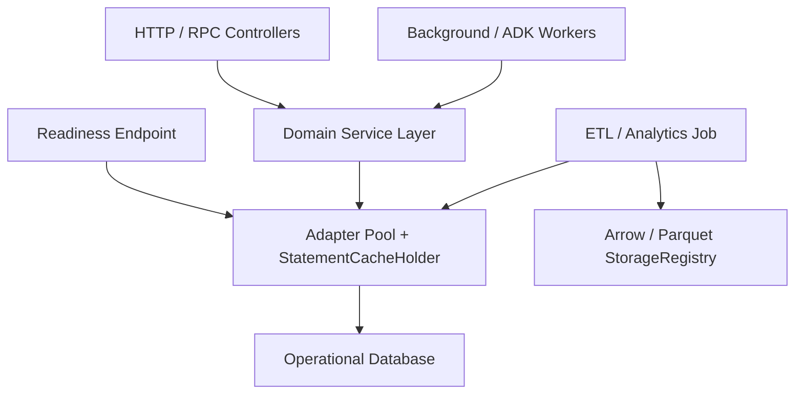

# Production Recipes

Production services combine SQLSpec's session primitives, filters, storage pipelines, and connection pools into repeatable operational patterns. Each recipe in this section focuses on one concrete architecture pattern backed by runnable SQLite examples and cross-adapter guidance.

## Recipe Catalog

| Recipe | Problem Solved | Key SQLSpec APIs |
| --- | --- | --- |
| [Service Layer](service-layer.md) | Encapsulate domain reads, existence checks, pagination, and atomic write transactions without leaking raw session lifecycles into route handlers or CLI callers. | `SQLSpecSyncService`, `SQLSpecAsyncService`, `begin_transaction`, `get_one`, `exists`, `paginate` |
| [Multi-Tenancy](multi-tenancy.md) | Isolate tenant data across dedicated databases (`bind_key`), per-tenant schemas (`search_path` / `current_schema`), or row-level predicates (`tenant_id`). | `SQLSpec`, `bind_key`, `provide_session`, `StatementFilter`, PostgreSQL `SET LOCAL` |
| [Health Checks](health-checks.md) | Expose bounded-timeout Kubernetes liveness and readiness probes without exhausting connection pools or polluting application telemetry. | `provide_session`, `select_value`, `asyncio.timeout`, `SamplingConfig` |
| [ETL and Bulk Ingest](etl-and-bulk-ingest.md) | Move analytical or operational datasets between databases and Parquet/Arrow object storage without exhausting worker memory. | `select_stream`, `execute_many`, `select_to_arrow`, `select_to_storage`, `load_from_arrow`, `load_from_storage` |

## Choosing When to Introduce a Pattern

### Start Direct, Add Structure Where Needed

For small microservices, background scripts, or single-query HTTP routes, injecting a driver session directly (`session: AsyncpgDriver` or `with config.provide_session() as session:`) keeps call stacks shallow and explicit.

Introduce higher-level recipes as operational requirements grow:

- **Adopt [Service Layer](service-layer.md)** when multiple HTTP controllers, background workers, and CLI commands share domain queries, offset/keyset pagination, and multi-statement write transactions.
- **Adopt [Multi-Tenancy](multi-tenancy.md)** when onboarding enterprise customers that require strict schema, database, or row-level isolation guarantees.
- **Adopt [Health Checks](health-checks.md)** before deploying pooled adapters behind load balancers, Cloud Run, or Kubernetes readiness probes.
- **Adopt [ETL and Bulk Ingest](etl-and-bulk-ingest.md)** whenever batch jobs process more than a few thousand rows or bridge transactional tables to DuckDB, BigQuery, S3/GCS Parquet, or Oracle `DBMS_CLOUD`.

## Composing Recipes with Framework Integrations

Every recipe in this section works unchanged inside SQLSpec's first-party framework integrations:

- **Litestar and Dishka**: Inject `SQLSpecAsyncService` subclasses as request-scoped dependencies backed by `SQLSpecPlugin` or a Dishka `Provider`.
- **FastAPI and Starlette**: Resolve tenant-scoped sessions inside `Depends(...)` functions and attach `CorrelationContext` IDs in ASGI middleware.
- **Google ADK**: Pair domain service layers alongside `SQLSpecSessionService` and `SQLSpecMemoryService` on the same underlying database pool.

See [Integrations](/integrations/) for framework-specific wiring examples.

## Composition Architecture

In a typical production service, HTTP controllers and background workers depend on thin domain services backed by shared `SQLSpec` configurations, readiness probes monitor pool health out-of-band, and batch workers stream analytical extracts to object storage:



## Decision Matrix by Workload Shape

| Workload Requirement | Recommended Primitive | Avoid |
| --- | --- | --- |
| Single-row lookup or paginated list endpoint | `SQLSpecAsyncService.get_one` / `paginate_limit_offset` / `paginate_cursor` | Opening nested manual transactions around read-only queries |
| Multi-table write with audit log insert | `async with service.begin_transaction() as session:` | Committing each statement independently across separate pool checkouts |
| Per-tenant schema or row isolation | `SET LOCAL search_path` inside a transaction or mandatory `tenant_id` filter | Session-level `SET search_path` without reset on pooled connections |
| Load-balancer readiness check every 5 seconds | `SELECT 1` inside `asyncio.timeout(1.0)` with `SamplingConfig` | Unbounded probe timeouts or multi-join table scans |
| Exporting 5M rows to S3/GCS Parquet | `session.select_to_storage(..., format_hint="parquet")` | Loading `session.select(...)` into a single Python `list[dict]` |

## Production Checklist Before Launch

1. **Pool Bounds Match Database Limits**: Verify `(worker_processes * pool_max_size)` stays safely below PostgreSQL `max_connections`, MySQL `max_connections`, or Oracle session limits (or deploy behind a pooler configured in [Databases](/databases/)).
2. **Explicit Shutdown Hooks**: Confirm `config.close_pool()` / `await config.close_pool()` runs during ASGI lifespan teardown or worker exit.
3. **Observability and Redaction Enabled**: Enable `RedactionConfig(mask_parameters=True)` and `SamplingConfig(force_sample_on_error=True)` before routing live customer traffic.
4. **Migration Dry-Run in CI**: Run `uv run sqlspec upgrade --dry-run` in pull request checks alongside `pytest`.

### Shared Application Wiring Skeleton

Construct `SQLSpec` once per process, register your configurations with explicit `bind_key` names, load `.sql` files, and inject the resulting config and loader into your domain services and health endpoints:

```python
from sqlspec import SQLSpec
from sqlspec.adapters.sqlite import SqliteConfig
from sqlspec.observability import (
    ObservabilityConfig,
    RedactionConfig,
    SamplingConfig,
)
from sqlspec.service import SQLSpecSyncService

spec = SQLSpec(
    observability_config=ObservabilityConfig(
        sampling=SamplingConfig(sample_rate=0.1, force_sample_on_error=True),
        redaction=RedactionConfig(mask_parameters=True),
    )
)
primary = spec.add_config(
    SqliteConfig(bind_key="primary", connection_config={"database": ":memory:"})
)
billing_service = SQLSpecSyncService(config=primary, loader=spec.loader)
```
