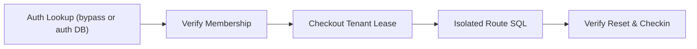

# Tenant Framework Integration

Bind every request connection to a tenant the authenticated caller is authorized
to access. Start with the non-superuser role and row-level security (RLS) policy
in [Multi-Tenancy](multi-tenancy.md). Request parameters, session keys, and
headers let an authenticated user select among their verified memberships; they
never grant access on their own.



## Installation

=== "uv"

    ```bash
    uv add "sqlspec[asyncpg,litestar]"
    ```

=== "pip"

    ```bash
    pip install "sqlspec[asyncpg,litestar]"
    ```

=== "pdm"

    ```bash
    pdm add "sqlspec[asyncpg,litestar]"
    ```

=== "poetry"

    ```bash
    poetry add "sqlspec[asyncpg,litestar]"
    ```

Replace `litestar` with `fastapi`, `starlette`, `flask`, or `sanic` to match
your web framework.

## Account Tables and User Lookup SQL

Authentication runs before the request has selected a tenant, while a database
configuration with `tenant_strategy="rls"` refuses unlabeled checkouts. You can
keep account and membership tables in the same PostgreSQL database (without a
tenant RLS filter on the lookup tables, or with a dedicated login lookup policy)
or place them in a separate authentication database.

For a single PostgreSQL database using the `tenant_app` role from
[Multi-Tenancy](multi-tenancy.md), create shared account and membership tables
alongside the RLS-protected `projects` table:

```sql
CREATE TABLE public.users (
    id text PRIMARY KEY,
    email text UNIQUE NOT NULL,
    password_hash text NOT NULL,
    default_org text
);

CREATE TABLE public.user_org_memberships (
    user_id text NOT NULL REFERENCES public.users (id) ON DELETE CASCADE,
    org_id text NOT NULL,
    role text NOT NULL DEFAULT 'member',
    PRIMARY KEY (user_id, org_id)
);

GRANT SELECT ON public.users, public.user_org_memberships TO tenant_app;
```

Authentication callbacks load the caller and all verified memberships in one
`LEFT JOIN ... GROUP BY` query (`array_remove(array_agg(m.org_id), NULL)`).

## Litestar Single-Database JWT Flow

Pass `AsyncpgConfig` directly to `SQLSpecPlugin(config)`. Inside
`retrieve_user_handler`, open a short-lived lookup session with
`config.provide_session(bypass_tenant=True)` so authentication can read `users`
and `user_org_memberships` before a tenant is chosen. Bypass skips SQLSpec's
tenant GUC setup for that checkout while keeping database privileges and RLS
policies on tenant tables active.

```python
import os
from typing import Any

import msgspec
from litestar import Litestar, get, post
from litestar.di import NamedDependency
from litestar.exceptions import NotAuthorizedException
from litestar.security.jwt import JWTAuth, Token

from sqlspec.adapters.asyncpg import AsyncpgConfig, AsyncpgDriver
from sqlspec.extensions.litestar import SQLSpecPlugin, require_tenant


class User(msgspec.Struct):
    id: str
    default_org: str | None
    org_ids: list[str]


class LoginRequest(msgspec.Struct):
    email: str
    password: str


config = AsyncpgConfig(
    connection_config={"dsn": os.environ["DATABASE_URL"]},
    driver_features={"tenant_strategy": "rls"},
    extension_config={
        "litestar": {
            "commit_mode": "autocommit",
            "tenant_user_attr": "default_org",
            "tenant_memberships_attr": "org_ids",
            "tenant_path_parameter": "org_id",
            "tenant_header": "x-org-id",
        }
    },
)


async def retrieve_user_handler(token: Token, connection: Any) -> User | None:
    async with config.provide_session(bypass_tenant=True) as session:
        return await session.select_one_or_none(
            "SELECT u.id, u.default_org, "
            "array_remove(array_agg(m.org_id ORDER BY m.org_id), NULL) AS org_ids "
            "FROM public.users AS u "
            "LEFT JOIN public.user_org_memberships AS m ON m.user_id = u.id "
            "WHERE u.id = :id GROUP BY u.id, u.default_org",
            id=token.sub,
            schema_type=User,
        )


jwt_auth = JWTAuth[User](
    token_secret=os.environ["JWT_SIGNING_KEY"],
    retrieve_user_handler=retrieve_user_handler,
    exclude=["/login", "/health"],
)


@post("/login", opt={"exclude_from_auth": True, "tenant_bypass": True})
async def login(
    data: LoginRequest, db_session: NamedDependency[AsyncpgDriver]
) -> dict[str, str]:
    row = await db_session.select_one_or_none(
        "SELECT id, password_hash FROM public.users WHERE email = :email",
        email=data.email,
    )
    if row is None or not row["password_hash"]:
        raise NotAuthorizedException("Invalid credentials")
    return {"access_token": jwt_auth.create_token(identifier=row["id"])}


@get("/me/orgs", opt={"tenant_bypass": True})
async def my_orgs(request: Any) -> list[str]:
    return list(request.user.org_ids)


@get("/orgs/{org_id:str}/projects", guards=[require_tenant()])
async def org_projects(
    db_session: NamedDependency[AsyncpgDriver],
) -> list[dict[str, Any]]:
    return await db_session.select("SELECT id, name FROM public.projects")


app = Litestar(
    route_handlers=[login, my_orgs, org_projects],
    on_app_init=[jwt_auth.on_app_init],
    plugins=[SQLSpecPlugin(config)],
)
```

Key behaviors:

- `SQLSpecPlugin(config)` needs no separate `SQLSpec()` registry and attaches to
  `app.state.sqlspec` in `on_app_init`. Litestar's `JWTAuth` and `SessionAuth`
  still attach via `on_app_init` because they expose an app-init hook rather than
  a plugin object.
- `require_tenant()` inherits `tenant_user_attr`, `tenant_memberships_attr`,
  `tenant_path_parameter`, `tenant_session_key`, `tenant_header`,
  `tenant_variables_attr`, and `tenant_jwt_claim` from the plugin configuration.
  Pass keyword overrides only for per-route differences (or `config_key` when
  multiple tenant databases use distinct selector names), and place
  `guards=[require_tenant()]` on a `Controller` to cover all of its routes while
  honoring `opt={"tenant_bypass": True}` (see
  [Litestar Integration](../../integrations/litestar.md#tenant-aware-requests)).
- Routes without a path parameter accept `x-org-id` or fall back to
  `User.default_org` when in `org_ids`. Even without `require_tenant()`,
  injecting `db_session` or `db_connection` enforces the same rules (`401` /
  `403` on HTTP, `4001` / `4003` on WebSockets).

Tenant source precedence: `opt={"tenant_bypass": True}` ->
`set_connection_tenant(connection, tenant_id)` -> custom `tenant_extractor` ->
verified path parameter, server session key, or configured header validated
against `org_ids` (falling back to verified `default_org` or a sole membership)
-> an ambient `TenantContext` scope bound by outer middleware. A disallowed
selector always fails closed with `403`.

## Separate Auth and Tenant Databases

When user accounts and sessions live in a dedicated authentication database,
pass a list of configs to `SQLSpecPlugin([auth_config, tenant_config])`. The
authentication store and login routes read `auth_config` without any bypass
scope, and organization switching verifies membership before updating the
server-side session:

```python
import os
from typing import Any

import msgspec
from litestar import Litestar, Request, get, post
from litestar.di import NamedDependency
from litestar.exceptions import PermissionDeniedException
from litestar.middleware.session.server_side import ServerSideSessionConfig
from litestar.params import FromPath
from litestar.security.session_auth import SessionAuth

from sqlspec.adapters.asyncpg import AsyncpgConfig, AsyncpgDriver
from sqlspec.adapters.asyncpg.litestar import AsyncpgStore
from sqlspec.extensions.litestar import SQLSpecPlugin, require_tenant


class Account(msgspec.Struct):
    id: str
    org_ids: list[str]


auth_config = AsyncpgConfig(
    bind_key="auth",
    connection_config={"dsn": os.environ["AUTH_DATABASE_URL"]},
    extension_config={
        "litestar": {
            "session_key": "auth_db",
            "connection_key": "auth_conn",
            "pool_key": "auth_pool",
            "session_table": True,
        }
    },
)

tenant_config = AsyncpgConfig(
    bind_key="tenant",
    connection_config={"dsn": os.environ["TENANT_DATABASE_URL"]},
    driver_features={"tenant_strategy": "rls"},
    extension_config={
        "litestar": {
            "commit_mode": "autocommit",
            "tenant_memberships_attr": "org_ids",
            "tenant_path_parameter": "org_id",
            "tenant_session_key": "active_org",
        }
    },
)


async def retrieve_session_user(
    session: dict[str, Any], connection: Any
) -> Account | None:
    user_id = session.get("user_id")
    if not user_id:
        return None
    async with auth_config.provide_session() as auth_db:
        return await auth_db.select_one_or_none(
            "SELECT u.id, array_remove(array_agg(m.org_id), NULL) AS org_ids "
            "FROM public.users AS u "
            "LEFT JOIN public.user_org_memberships AS m ON m.user_id = u.id "
            "WHERE u.id = :user_id GROUP BY u.id",
            user_id=user_id,
            schema_type=Account,
        )


session_auth = SessionAuth[Account, Any](
    retrieve_user_handler=retrieve_session_user,
    session_backend_config=ServerSideSessionConfig(),
    exclude=["/health"],
)


@post("/session/org/{org_id:str}")
async def switch_org(
    org_id: FromPath[str], request: Request[Account, Any, Any]
) -> dict[str, str]:
    if org_id not in request.user.org_ids:
        raise PermissionDeniedException("Not a member of this organization")
    request.set_session({**request.session, "active_org": org_id})
    return {"active_org": org_id}


@get("/projects", guards=[require_tenant()])
async def projects(
    db_session: NamedDependency[AsyncpgDriver],
) -> list[dict[str, Any]]:
    return await db_session.select("SELECT id, name FROM public.projects")


app = Litestar(
    route_handlers=[switch_org, projects],
    on_app_init=[session_auth.on_app_init],
    stores={"sessions": AsyncpgStore(config=auth_config)},
    plugins=[SQLSpecPlugin([auth_config, tenant_config])],
)
```

## Litestar Security Integration

When using `litestar-security`, register `SecurityPlugin` alongside
`SQLSpecPlugin` with no `on_app_init` hooks. SQLSpec natively reads
`Principal`, `SecurityContext`, `AuthorizationSnapshot` (`tenant_ids`,
`tenant_roles`, and `attributes`), `SessionHandle`, `JWTClaims`,
`CredentialRestrictions`, and route guards built with `requires_tenant(...)` or
`requires_tenant_role(...)`:

```python
import os
from typing import Any

import msgspec
from litestar import Litestar, get
from litestar.di import NamedDependency
from litestar_security import (
    AuthorizationSnapshot, CurrentUser, JWTAuthConfig, Principal,
    SecureController, SecurityConfig, SecurityPlugin, public,
    requires_tenant, requires_tenant_role,
)

from sqlspec.adapters.asyncpg import AsyncpgConfig, AsyncpgDriver
from sqlspec.extensions.litestar import SQLSpecPlugin


class User(msgspec.Struct):
    id: str
    default_org: str | None


config = AsyncpgConfig(
    connection_config={"dsn": os.environ["DATABASE_URL"]},
    driver_features={"tenant_strategy": "rls"},
    extension_config={
        "litestar": {
            "commit_mode": "autocommit",
            "tenant_user_attr": "default_org",
            "tenant_path_parameter": "org_id",
        }
    },
)


class OrgAuthorizationResolver:
    async def resolve(self, principal: Principal[User]) -> AuthorizationSnapshot:
        async with config.provide_session(bypass_tenant=True) as session:
            rows = await session.select(
                "SELECT org_id, role FROM public.user_org_memberships "
                "WHERE user_id = :id",
                id=principal.id,
            )
        roles: dict[str, set[str]] = {}
        for row in rows:
            roles.setdefault(row["org_id"], set()).add(row["role"])
        frozen = {org: frozenset(items) for org, items in roles.items()}
        default = principal.user.default_org if principal.user else None
        return AuthorizationSnapshot(
            tenant_ids=frozenset(frozen),
            tenant_roles=frozen,
            attributes={"default_org": default} if default else {},
        )


class ProjectController(SecureController):
    path = "/orgs/{org_id:str}/projects"

    @get("/", guards=[requires_tenant(tenant_parameter="org_id")])
    async def list_projects(
        self,
        current_user: CurrentUser[User],
        db_session: NamedDependency[AsyncpgDriver],
    ) -> list[dict[str, Any]]:
        return await db_session.select("SELECT id, name FROM public.projects")

    @get(
        "/editable",
        guards=[
            requires_tenant_role(
                tenant_parameter="org_id", roles=frozenset({"editor", "admin"})
            )
        ],
    )
    async def list_editable(
        self, db_session: NamedDependency[AsyncpgDriver]
    ) -> list[dict[str, Any]]:
        return await db_session.select("SELECT id, name FROM public.projects")


@get("/health", auth=public(), opt={"tenant_bypass": True})
async def health(db_session: NamedDependency[AsyncpgDriver]) -> dict[str, int]:
    return {"ok": await db_session.select_value("SELECT 1")}


app = Litestar(
    route_handlers=[ProjectController, health],
    plugins=[
        SQLSpecPlugin(config),
        SecurityPlugin(SecurityConfig(
            providers=[JWTAuthConfig(signing_key=os.environ["JWT_SIGNING_KEY"])],
            authorization_resolver=OrgAuthorizationResolver(),
        )),
    ],
)
```

How SQLSpec cooperates with `litestar-security`:

- `AuthorizationSnapshot.tenant_ids` and non-empty `tenant_roles` entries merge
  into the caller's verified tenant set automatically.
- `CredentialRestrictions(tenant_ids=...)` attached by scoped API keys or
  delegated tokens clamp the allowed tenant set by intersection before selector
  validation; an out-of-scope tenant path or header fails closed with `403`.
- `requires_tenant(tenant_parameter="org_id")` and
  `requires_tenant_role(tenant_parameter="org_id", roles=...)` (including guards
  nested inside `requires_all_of` or `requires_any_of`) expose the path selector
  name to SQLSpec, so you do not need to stack `require_tenant()` next to them.
  Inside `requires_any_of`, a non-tenant branch passing still requires the path
  value to match a verified membership before database checkout.

## FastAPI, Starlette, Flask, and Sanic

Outside Litestar, authentication often runs inside route dependencies (FastAPI
`Depends(...)`) or view decorators rather than outer ASGI middleware. When a
database configuration enables `tenant_strategy` without a `tenant_extractor`
(or when `tenant_extractor` returns `None`), SQLSpec defers tenant connection
checkout until the route requests a session. Public endpoints such as `/health`,
`/login`, and FastAPI's `/docs` never check out a tenant connection.

### FastAPI Dependency Resolution

Verify membership inside an async dependency (using
`config.provide_session(bypass_tenant=True)` in single-database apps or a
dedicated auth bind in multi-database apps), call
`set_request_tenant(request, org_id)`, and inject
`Depends(db_ext.provide_session())`:

```python
from typing import Annotated, Any
from fastapi import Depends, FastAPI, HTTPException, Request
from sqlspec.adapters.asyncpg import AsyncpgConfig, AsyncpgDriver
from sqlspec.extensions.fastapi import SQLSpecPlugin, set_request_tenant

app = FastAPI()
config = AsyncpgConfig(
    connection_config={"dsn": "postgresql://tenant_app@localhost/app"},
    driver_features={"tenant_strategy": "rls"},
    extension_config={"fastapi": {"commit_mode": "autocommit"}},
)
db_ext = SQLSpecPlugin(config, app)


async def authorize_org(request: Request, org_id: str) -> str:
    user_id = request.headers.get("x-verified-user")
    if not user_id:
        raise HTTPException(status_code=401, detail="Authentication required")
    async with config.provide_session(bypass_tenant=True) as lookup:
        allowed = await lookup.select_one_or_none(
            "SELECT 1 FROM public.user_org_memberships "
            "WHERE user_id = :uid AND org_id = :org",
            uid=user_id,
            org=org_id,
        )
    if allowed is None:
        raise HTTPException(status_code=403, detail="Forbidden organization")
    set_request_tenant(request, org_id)
    return org_id


@app.get("/orgs/{org_id}/projects")
async def list_projects(
    _org: Annotated[str, Depends(authorize_org)],
    db: Annotated[AsyncpgDriver, Depends(db_ext.provide_session())],
) -> list[dict[str, Any]]:
    return await db.select("SELECT id, name FROM public.projects")
```

See [FastAPI Tenant-Aware Requests](../../integrations/fastapi.md#tenant-aware-requests)
for the complete multi-database example separating `auth_db` and `tenant_db`.

### Starlette, Flask, and Sanic In-Route Resolution

Each framework exports `set_request_tenant` alongside `SQLSpecPlugin`:

- **Starlette**: Verify membership, call `set_request_tenant(request, org_id)`,
  and await `db.get_session_async(request)` (`db.get_session(request)` on sync
  adapters); see [Starlette Tenant-Aware Requests](../../integrations/starlette.md#tenant-aware-requests).
- **Sanic**: Verify membership, call `set_request_tenant(request, org_id)`, and
  await `db.get_session_async(request)` (`db.get_session(request)` when an
  upfront `tenant_extractor` or sync adapter is active); see
  [Sanic Tenant-Aware Requests](../../integrations/sanic.md#tenant-aware-requests).
- **Flask**: Verify membership, call `set_request_tenant(org_id)`, and call
  `plugin.get_session()`, which bridges both sync and portal-backed async
  adapters lazily; see [Flask Tenant-Aware Requests](../../integrations/flask.md#tenant-aware-requests).

### Upfront Middleware Extractors

When authentication middleware runs before SQLSpec and populates `scope["user"]`,
`g.user`, or `request.ctx.user`, attach a per-bind `tenant_extractor` under
`extension_config["starlette"]`, `"fastapi"`, `"flask"`, or `"sanic"` to acquire
leases eagerly whenever a verified tenant is resolved:

```python
from typing import Any
from sqlspec.adapters.asyncpg import AsyncpgConfig


def verified_tenant(scope: dict[str, Any]) -> str | None:
    user = scope.get("user")
    if user is None or not getattr(user, "is_authenticated", False):
        return None
    selected = getattr(user, "default_org", None)
    return selected if selected in getattr(user, "org_ids", ()) else None


config = AsyncpgConfig(
    connection_config={"dsn": "postgresql://tenant_app@localhost/app"},
    driver_features={"tenant_strategy": "rls"},
    extension_config={
        "starlette": {
            "tenant_extractor": verified_tenant,
            "commit_mode": "autocommit",
        }
    },
)
```

Each configuration evaluates its own `tenant_extractor` independently, so an
auth database without an extractor and tenant databases with distinct extractors
coexist in one `SQLSpecPlugin`. Outside a framework plugin, wrap ASGI apps in
`SQLSpecTenantMiddleware(app, extractor=...)` to bind `TenantContext` across
HTTP and WebSocket scopes.

## Request Lifetime and Streaming Semantics

- **Per-connection capture**: Framework plugins snapshot `TenantContextPayload`
  per connection lease, keeping auth and multi-tenant binds isolated through
  commit, rollback, and checkin.
- **Streaming and background tasks**: Starlette and FastAPI hold leases open
  through streaming bodies and Starlette `BackgroundTask` completion, rolling
  back uncommitted work on disconnects, errors, or cancellations before checkin.
- **Detached workers**: Never pass a request session to work outliving the HTTP
  response; pass the verified `tenant_id` and open
  `config.provide_session(tenant=tenant_id)` in the worker (see
  [Tenant Operations](multi-tenancy-operations.md)).
