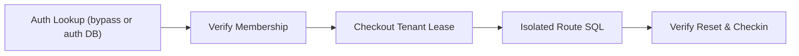

# Tenant Request Contract

Bind every request connection to a tenant the authenticated caller is authorized
to access. Start with the non-superuser role and row-level security (RLS) policy
in [Multi-Tenancy](multi-tenancy.md). Request parameters, session keys, and
headers let an authenticated user select among their verified memberships; they
never grant access on their own.

This page describes the rules every framework plugin follows. Each
[framework guide](#framework-guides) shows complete examples for one framework.



## One Request Contract

Litestar, FastAPI, Starlette, Flask, and Sanic follow the same rules once a
registered configuration enables `driver_features["tenant_strategy"]`. Without
one, the plugin installs no tenant handling and adds no per-request work.

- **Lazy resolution**: At request start the plugin binds a lazy resolver; it does
  not run your extractor or auth lookup. The tenant is resolved the first time a
  lease, `provide_session()`, a `SQLSpec*Service(config=...)`, or
  `TenantContext.get()` / `TenantContext.require()` needs it, once per
  database configuration. Async extractors resolve at async access points; use
  `await TenantContext.aget()` instead of the synchronous `get()` when your
  extractor is asynchronous.
- **Precedence** (highest first):
    1. `provide_session(tenant=...)` or `provide_session(bypass_tenant=True)`.
    2. A `TenantContext.scope(...)` or `TenantContext.bypass()` entered inside the handler.
    3. Route resolution: the `tenant_bypass` route marker (or Litestar
       `opt={"tenant_bypass": True}`), the request receipt from
       `set_request_tenant(...)` / `set_connection_tenant(...)`, the configured
       `tenant_extractor`, and, on Litestar, verified auth resolution.
    4. A `TenantContext` scope bound outside the request, such as
       `SQLSpecTenantMiddleware` installed in front of the application.
- **No tenant**: An extractor that returns `None` only means that source has no
  tenant; resolution continues down the list. If nothing resolves and the route
  is not bypassed, the request fails with the framework's 401 (no authenticated
  user) or 403 (authenticated user without an authorized tenant) instead of a
  500. Scripts and workers outside a request still get `TenantContextError`.
- **Streaming and background work**: Pending resolutions finish before the final
  response message, so streaming bodies and background tasks keep the tenant
  resolved for their request; nothing reads request state after the response.
- **Configuration**: `tenant_extractor` requires `tenant_strategy` on the same
  configuration.
- **Sync accessors on async configurations**: The synchronous session accessor
  (`plugin.get_session(request)`, or Litestar's
  `plugin.provide_request_session(key, state, scope)`) returns a session that
  opens the connection under the request tenant on its first awaited call.
  Flask's `plugin.get_session()` blocks on the plugin's portal instead.
- **Ambient middleware placement**: Register an outer tenant source (Flask and
  Sanic request hooks, ASGI middleware) before the SQLSpec plugin so it counts
  as ambient; a source that runs after the plugin's request hook behaves like a
  handler scope.

Mark public routes with `tenant_bypass`, exported by every framework extension:

```python
from sqlspec.extensions.starlette import tenant_bypass


@tenant_bypass
async def health(request):
    ...
```

## Installation

=== "uv"

    ```bash
    uv add "sqlspec[asyncpg,litestar]"
    ```

=== "pip"

    ```bash
    pip install "sqlspec[asyncpg,litestar]"
    ```

=== "pdm"

    ```bash
    pdm add "sqlspec[asyncpg,litestar]"
    ```

=== "poetry"

    ```bash
    poetry add "sqlspec[asyncpg,litestar]"
    ```

Replace `litestar` with `fastapi`, `starlette`, `flask`, or `sanic` to match
your web framework. Tenant strategies are available on the `asyncpg`,
`psycopg`, `psqlpy`, `cockroach_asyncpg`, `cockroach_psycopg`, `oracledb`,
`mssql_python`, `pymssql`, `db2`, and `snowflake` adapters.

## Account Tables and User Lookup SQL

Authentication runs before the request has selected a tenant, while a database
configuration with `tenant_strategy="rls"` refuses unlabeled checkouts. You can
keep account and membership tables in the same PostgreSQL database (without a
tenant RLS filter on the lookup tables, or with a dedicated login lookup policy)
or place them in a separate authentication database.

For a single PostgreSQL database using the `tenant_app` role from
[Multi-Tenancy](multi-tenancy.md), create shared account and membership tables
alongside the RLS-protected `projects` table:

```sql
CREATE TABLE public.users (
    id text PRIMARY KEY,
    email text UNIQUE NOT NULL,
    password_hash text NOT NULL,
    default_org text
);

CREATE TABLE public.user_org_memberships (
    user_id text NOT NULL REFERENCES public.users (id) ON DELETE CASCADE,
    org_id text NOT NULL,
    role text NOT NULL DEFAULT 'member',
    PRIMARY KEY (user_id, org_id)
);

GRANT SELECT ON public.users, public.user_org_memberships TO tenant_app;
```

Authentication callbacks load the caller and all verified memberships in one
`LEFT JOIN ... GROUP BY` query (`array_remove(array_agg(m.org_id), NULL)`).
In a single database, run these lookups through
`config.provide_session(bypass_tenant=True)`: bypass skips SQLSpec's tenant
session setup for that checkout while database privileges and RLS policies on
tenant tables stay active. With a separate authentication database, query the
auth configuration directly; it has no tenant strategy and needs no bypass.

## Upfront Tenant Extractors

When authentication middleware runs before SQLSpec and has already verified the
caller, attach a `tenant_extractor` to each tenant configuration under
`extension_config["<framework>"]` instead of calling `set_request_tenant(...)`
in every route. The extractor returns a `TenantContextPayload`, string, UUID,
or `None`. SQLSpec calls it on first use, not at request start, and at most once
per configuration per request.

| Framework | Extractor argument | Async extractors |
| --- | --- | --- |
| Litestar | ASGI scope | Supported |
| FastAPI | ASGI scope | Supported |
| Starlette | ASGI scope | Supported |
| Flask | Flask request, or no argument | Rejected |
| Sanic | Sanic request | Supported |

- **Trust only verified state**: Read the authenticated user your middleware
  stored (`scope["user"]`, `g.user`, `request.ctx.user`) and return a selector
  only when it is one of that user's verified memberships. Never return a raw
  header or path value unchecked.
- **Return `None` when the source has no tenant**: Resolution continues with the
  ambient scope, and the request fails with 401 or 403 if nothing resolves.
- **Independent per configuration**: Each configuration evaluates its own
  extractor, so an auth database without an extractor and tenant databases with
  distinct extractors coexist in one `SQLSpecPlugin`.
- **Receipts first**: A request receipt for the same configuration
  (`set_request_tenant(...)`, or `set_connection_tenant(...)` on Litestar) takes
  precedence over its extractor.

## Bare ASGI Applications

Outside a framework plugin, wrap any ASGI application in
`SQLSpecTenantMiddleware(app, extractor=...)` to bind `TenantContext` for each
HTTP and WebSocket call. The middleware binds the extractor result, including
`None`, for the whole call and restores the caller's context on completion,
errors, and cancellation. In front of a framework plugin, this middleware
supplies the ambient scope, the lowest entry in the precedence list.

```python
from typing import Any

from sqlspec.utils.tenant import SQLSpecTenantMiddleware


async def inner_app(scope: dict[str, Any], receive: Any, send: Any) -> None:
    ...


def verified_tenant(scope: dict[str, Any]) -> str | None:
    user = scope.get("user")
    if user is None:
        return None
    selected = getattr(user, "default_org", None)
    return selected if selected in getattr(user, "org_ids", ()) else None


app = SQLSpecTenantMiddleware(inner_app, extractor=verified_tenant)
```

`sqlspec.extensions.litestar`, `sqlspec.extensions.starlette`, and
`sqlspec.extensions.fastapi` also export `SQLSpecTenantMiddleware`.

## Request Lifetime and Streaming Semantics

- **Per-connection capture**: Each lease snapshots its `TenantContextPayload`,
  keeping auth and multi-tenant binds isolated through commit, rollback, and
  checkin.
- **Streaming and background tasks**: The tenant resolved for the request stays
  in effect for streaming bodies and background tasks in every framework.
  Starlette and FastAPI also hold request leases open through streaming bodies
  and `BackgroundTask` completion; Litestar and Sanic release the request
  connection when the response starts, so open a new session inside the stream
  or task.
- **Detached workers**: Never pass a request session to work outliving the HTTP
  response; pass the verified `tenant_id` and open
  `config.provide_session(tenant=tenant_id)` in the worker (see
  [Tenant Operations](multi-tenancy-operations.md)).

## Framework Guides

Each guide follows the same outline: how the framework resolves the request
tenant, a single-database example, the upfront extractor, public routes,
streaming and background work, and sync and async accessors.

- [Litestar](multi-tenancy-litestar.md): dependency injection, `require_tenant()`
  guards, JWT and session auth, separate auth databases, and `litestar-security`.
- [FastAPI](multi-tenancy-fastapi.md): authorization dependencies with
  `Depends(...)`, including separate auth and tenant databases.
- [Starlette](multi-tenancy-starlette.md): in-route membership checks with
  `set_request_tenant(request, ...)` and `get_session_async(request)`.
- [Flask](multi-tenancy-flask.md): views and `before_request` hooks with
  `set_request_tenant(...)` and `plugin.get_session()`.
- [Sanic](multi-tenancy-sanic.md): request middleware and routes with
  `set_request_tenant(request, ...)` and `get_session_async(request)`.
